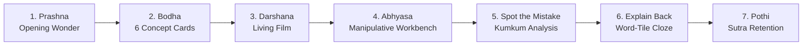
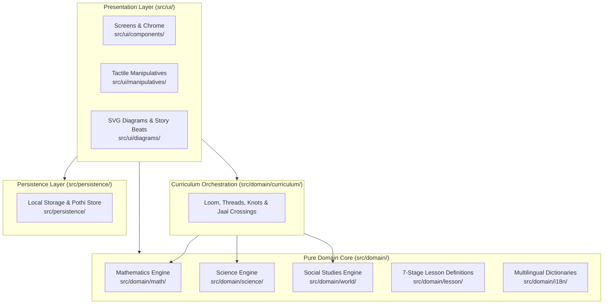

# Gurukul (Learn GPT 2.0)

> **A calm, visual, tactile learning companion for 10-year-olds (Class 5) in India.**  
> Delivering deep conceptual understanding across **Mathematics (Ganita)**, **Science (Vijnana)**, and **Social Studies (Loka)** in **English, Hindi, Telugu, Bengali, and Tamil**.

[](https://pages.cloudflare.com/)
[](#the-11-sensor-verification-harness)
[-blue)](#feature-catalog-001045)
[-purple)](#curriculum-topology--the-loom-architecture)
[-teal)](#pedagogical-invariants--zero-gamification)
[-success)](#technology-stack)

---

## Table of Contents
1. [Executive Summary & Pedagogical Ethos](#executive-summary--pedagogical-ethos)
2. [The 7-Stage Pedagogical Engine](#the-7-stage-pedagogical-engine)
3. [Curriculum Topology & The Loom Architecture](#curriculum-topology--the-loom-architecture)
4. [System Architecture & Engineering Invariants](#system-architecture--engineering-invariants)
5. [Technology Stack & Runtime Design](#technology-stack--runtime-design)
6. [The Agentic Delivery Standard & Spec-Driven Development](#the-agentic-delivery-standard--spec-driven-development)
7. [The 11-Sensor Verification Harness](#the-11-sensor-verification-harness)
8. [Feature Catalog (001–045)](#feature-catalog-001045)
9. [Architect's Inspection Guide](#architects-inspection-guide)
10. [Local Development & Deployment Runbook](#local-development--deployment-runbook)

---

## Executive Summary & Pedagogical Ethos

**Gurukul** re-imagines digital learning for children at the critical developmental age of 10 (NCERT / NEP 2020 Class 5 level). Rather than relying on gamified extrinsic rewards, Gurukul fosters deep intrinsic curiosity through **tactile interactive manipulatives**, **structured concept explanations**, and **calm contemplative pacing**.

### Pedagogical Invariants & Zero-Gamification
Contemporary EdTech routinely relies on Skinnerian reward schedules (points, streaks, confetti, leaderboard stress, and countdown timers). Gurukul strictly forbids these mechanisms by architectural invariant:
- **Zero Extrinsic Pressure**: No points, no XP, no badges, no streaks, no timers, and no leaderboards.
- **Calm Earthen Aesthetics**: A visual design language anchored in natural textures and hues—`--khadi` (warm parchment), `--terracotta` (burnt earth), `--forest` (deep green), `--ink` (slate charcoal), and `--kumkum` (vermilion).
- **Non-Punitive Error Analysis**: Mistakes are treated as valuable thinking artifacts. Kumkum red is reserved strictly as a gentle **focal pointer** ("look here"), never as an angry "wrong!" buzzer or cross mark.
- **Multilingual Script Purity**: Every concept is localized into 5 languages: **English**, **Hindi (हिन्दी)**, **Telugu (తెలుగు)**, **Bengali (বাংলা)**, and **Tamil (தமிழ்)** with 100% script fidelity and bilingual glossary bridge cards.

---

## The 7-Stage Pedagogical Engine

Every concept (Knot) in Gurukul follows an immutable 7-stage learning journey reflecting classical Indian cognitive stages (*Shravana* $\rightarrow$ *Manana* $\rightarrow$ *Nididhyasana*):



### 1. Prashna (Opening Wonder & Prediction)
Before instruction begins, the child encounters a low-stakes prediction scenario under 60 seconds with three conceptual choices (e.g., *"If you turn a 3×8 apple array sideways, who has more?"*). This commits the learner's intuition without fear of evaluation.

### 2. Bodha (Structured Concept Cards)
The concept is unfolded through 6 standardized cards:
1. **What (`what`)**: Concrete definition grounded in everyday realia.
2. **Idea (`idea`)**: The structural mental model (e.g., grouping into rows and columns).
3. **Why (`why`)**: The underlying principle or conservation law (e.g., rotational symmetry).
4. **Example (`example`)**: Step-by-step interactive worked demonstration with dynamic reveals.
5. **Where (`where`)**: Real-world applications (egg cartons, orchard planting, maps, astronomy).
6. **Sutra (`sutra`)**: A memorable aphorism encapsulating the core invariant.
- **Bilingual Bridge Cards**: Tapping highlighted terms opens a glossary card with audio pronunciation and native/English bridge terms.

### 3. Darshana (Living Film)
Procedural canvas and SVG animations present continuous visual stories (e.g., counting courtyard tiles, sliding parallelogram top edges, folding 3D cube nets, rotating celestial orbits).

### 4. Abhyasa (Interactive Tactile Workbench)
The core manipulative workspace. Direct manipulation controls (rubber rectangles, fair-share plates, marble logic gates, angle rotators, metric sliders, Venn loops) operate with:
- **Instant reversibility**: Touch, mouse, and keyboard operations update state in real time.
- **Synchronized dynamic representations**: Manipulatives continuously synchronize with mathematical representations ($W \times H = \text{Area}$, $P \implies Q$, step counts, balances).

### 5. Spot the Mistake (Focal Error Analysis)
Learners inspect a simulated peer's working (e.g., Varun, Farhan, Ananya) that contains a common conceptual trap.
- The learner taps the incorrect step.
- Kumkum red (`--kumkum`) gently illuminates the omitted or flawed step without alert sounds or negative phrasing.
- A worked explanation reinforces the correct principle.

### 6. Explain Back (Cloze Sentence Synthesis)
Learners demonstrate synthetic mastery by completing a cloze statement using draggable/clickable word tiles (e.g., Selecting `columns` and `equal to` to explain array commutativity).

### 7. Pothi & Sutra Stamping (Personalized Notebook)
Upon synthesis, the knot's timeless Sutra is permanently stamped into the child's **Pothi** (learning journal), preserved in local storage with audio recall and subject categorisation.

---

## Curriculum Topology & The Loom Architecture

Gurukul organizes Class 5 learning as a continuous **Loom of Knowledge**:
- **3 Shalas (Schools)**:
  - **Ganita Shala (Mathematics)**: Ganana (Arithmetic), Sankhya (Number sense), Guna (Multiplication & Factors), Kshetra (Geometry & Space), Mana (Measurement), Tarka (Logic & Sets), Jaal (Patterns & Sequences).
  - **Vijnana Shala (Science)**: Sharira (Digestion & Nutrition), Chalan (Forces, Friction & Ramps), Prakasha (Light, Shadow & Reflection).
  - **Loka Shala (Social Studies)**: Samaya (Timelines BCE/CE without year zero), Prithvi (Earth rotation, Day/Night & Seasons), Naksha (Cartography, Scale & Perspectives).
- **Scale**:
  - **18 Threads**
  - **74 Total Curriculum Knots**
  - **10 Inter-subject Jaal Crossings**: Deep multidisciplinary intersections (e.g., Sundial linking Timeclock $U3$ to Shadow geometry $R1$; TopView linking 3D Perspective $E4$ to Cartographic grid $G8$; FoodGraph linking Bar graphs $B1$ to Nutrition science $H2$).
  - **47 Playable Interactive Knots** fully implemented across Features 001–045.

---

## System Architecture & Engineering Invariants

Gurukul is structured as a **Pure Hexagonal / Clean Architecture** with strict layer boundaries verified at build time.



### Hard Engineering Invariants (Enforced by Tooling)
1. **INV-1: One Owning Module per Business Domain**: A business rule lives exclusively in its domain owner (`src/domain/math/`, `src/domain/science/`, `src/domain/world/`).
2. **INV-2: No Business Logic in Presentation**: UI components, templates, and screens only render and capture input. They never calculate mathematical formulas, science invariants, or classification logic.
3. **INV-3: Domain Purity**: Domain modules are 100% pure TypeScript. They never import UI, web-framework, DOM (`HTMLElement`, `window`, `document`), or persistence types.
4. **INV-4: Strict Dependency Flow**: Enforced via `dependency-cruiser` (`npx depcruise src`). Presentation imports domain; domain never imports presentation.
5. **INV-5: Router Root Invariant**: The application shell root container `<main id="view">` is strictly preserved. Screen components never alter `#view` ID, guaranteeing smooth client-side routing, language re-rendering, and teardown lifecycle.
6. **INV-6: Privacy & Child Safety by Design**: Zero telemetry, zero analytics tracking, zero cookies, zero external API dependencies. All learner progress is persisted locally in the browser under `gurukul:*`.

---

## Technology Stack & Runtime Design

| Tier | Technology | Purpose |
|---|---|---|
| **Language** | TypeScript 6.0 (Strict mode, ES2022) | High-integrity type safety across all domain rules and UI components. |
| **Build & Bundler** | Vite 8 + Rolldown | Blazing-fast development server, sub-second HMR, and ultra-compact static bundle. |
| **UI Framework** | Vanilla DOM Micro-Framework (`src/ui/util/dom.ts`) | **0 runtime dependencies**. High performance, zero virtual DOM overhead, clean memory lifecycle management. |
| **Router** | Hash Router (`src/ui/components/app/router.ts`) | Single-page hash routing (`/#/shala`, `/#/prashna`, `/#/bodha`, `/#/rect`, etc.) with in-memory state preservation. |
| **Audio & Speech** | Native Web Speech API & Web Audio Synthesizer | Text-to-speech for all 5 languages and calm audio chords without asset downloads. |
| **Styling** | Vanilla CSS Token System (`tokens.css`, `lesson.css`, `shell.css`) | Curated palette, flexible CSS grid/flexbox layouts, responsive scaling for 360px and 390px mobile viewports. |
| **Unit Testing** | Vitest 5 | 100% coverage on all mathematical, scientific, and curriculum algorithms. |
| **E2E & Acceptance** | Playwright 1.64 | Automated mobile viewport acceptance testing across Chromium, Firefox, WebKit. |
| **Architecture Verification** | Dependency Cruiser | Static verification preventing circular dependencies and layer leaks. |
| **Code Style** | ESLint 10 + Prettier 3 | Zero-warning linting policy and standardized code formatting. |
| **Hosting & Edge** | Cloudflare Pages / Workers (`wrangler.jsonc`) | Static single-page application hosted globally on Cloudflare edge network with SPA fallback. |

---

## The Agentic Delivery Standard & Spec-Driven Development

Gurukul was constructed using the **Agentic Delivery Standard (ADS)** and **Spec-Driven Development (SDD)** across 45 sequential feature cycles (Features 001 through 045).

### Spec Kit Lifecycle
For every feature:
1. **`spec.md`**: Defines pedagogical problem, user stories (`US1`–`US5`), and acceptance scenarios (`US<n>-AS<m>`).
2. **`plan.md`**: Outlines module ownership, pure domain functions, UI screens, dictionary keys, and test plan.
3. **`tasks.md`**: Detailed execution checklist spanning domain, aggregators, registry, curriculum, localization, UI screens, tests, and verification.
4. **`traceability.md`**: Automated requirement-to-test verification generated by `check_traceability.py`.
5. **`progress.md`**: Context preservation and session handoff tracking.
6. **`checks.md`**: Cryptographic evidence of passing the 11-sensor harness.

---

## The 11-Sensor Verification Harness

Before any code can be merged into `main`, it must pass the **11-Sensor Verification Harness** (`python3 scripts/harness/verify.py`):

```text
verify (full) - 11 check(s)
  PASS           harness-syntax (scripts/harness/*.py compile clean)
  PASS           format (npx prettier --check .)
  PASS           lint (npx eslint . --max-warnings=0)
  PASS           typecheck (npx tsc --noEmit)
  PASS           unit-tests (npx vitest run)
  PASS           acceptance-tests (npx playwright test tests/acceptance)
  PASS           architecture-rules (npx depcruise src)
  PASS           mockup-parity (Playwright visual & element parity tests)
  PASS           sweep (Full route sanity & zero-gamification checks)
  PASS           traceability (scripts/harness/check_traceability.py)
  PASS           test-integrity (scripts/harness/check_test_integrity.py)

RESULT: PASS - 11 check(s) (full)
```

- **Protection Against Weaker Tests**: `test-integrity` ensures that acceptance tests or assertions are never weakened, skipped, or deleted to force a green build.
- **Sweep Guard**: Detects prohibited gamification tokens (`.score`, `.streak`, `.points`, `.stars`, `.timer`, `.confetti`) and unapproved praise words across all views.

---

## Feature Catalog (001–045)

All 45 planned features are fully implemented, verified, and merged:

| Feature | Title | Knot(s) | Domain Focus |
|---|---|---|---|
| **001** | App Shell & Ashram Navigation | Shell | Ashram home, Shala looms, Language selector, Topbar |
| **002** | 7-Stage Lesson Engine | Engine | Prashna, Bodha, Darshana, Abhyasa, Mistake, Explain, Stop |
| **003** | Multiplication & Area Grid | M1–M5 | Equal groups, Tile covering, Commutative rotation, Room cuts, Rhythm |
| **004** | Fair Share & Division | D1–D4 | Sharing plates, Quotition, Remainder fractions, Long division |
| **005** | Geometry, Ropes & Symmetry | G1–G8 | Turns, Rope perimeter, Parallelogram shear, Kolam mirrors, Cube nets |
| **006** | Sets & Logic Foundations | S1–S3, L1–L4 | Venn rings, Universal claims, Logic gates, Implication |
| **007** | Advanced Logic & Fallacies | L1–L4 | Counterexamples, Boolean gates, Converse fallacy, Sequences |
| **008** | Pothi (Notebook) | Pothi | Sutra retention, memory palace, thumb indexing |
| **009** | Ashram Shell Hardening | Shell | PWA service worker, offline cache, sound controls |
| **010** | Ganita Shala Expansion | Ganita | Multi-thread loom integration, cross-subject Jaal links |
| **011** | Vijnana Shala (Science) | H1–H3, R1–R3, X1–X3 | Digestion track, Ramps & friction, Shadow clock |
| **012** | Loka Shala (Social Studies) | I1–I3, E1–E4, U1–U3 | Timelines (BCE/CE), Earth rotation & seasons, Map projection |
| **013** | Roman Numerals | N2 | Additive/subtractive Roman notation ($I, V, X, L, C, D, M$) |
| **014** | Fractions of a Collection | N4 | Discrete set partitioning, numerator/denominator subsets |
| **015** | Tenths & Hundredths (Decimals) | N5 | Decimal place value, metric hundredths grid |
| **016** | Regrouping in Addition/Subtraction | A1 | Multi-digit column addition/subtraction, base-10 borrowing |
| **017** | Estimation & Rounding | A2 | Nearest 10/100 rounding, mental bounds checking |
| **018** | Quotition Division (Grouping) | D2 | Repeated subtraction, discrete bundle count |
| **019** | Long Division Algorithm | D4 | Multi-step division standard algorithm, step quotient |
| **020** | Which Operation? | A3 | Word problem classification, mathematical model choice |
| **021** | Factors Make Rectangles | F1 | Area factorization, factor pairs, tile grid snapping |
| **022** | Primes & Composites | F2 | Sieve of Eratosthenes, rectangular decomposition proof |
| **023** | Divisibility Tests | F3 | Rules for 2, 3, 5, 9, 10, digit sum analysis |
| **024** | Common Factors & HCF | F4 | Intersecting factor Venn rings, Highest Common Factor |
| **025** | Angles as Turns | G1 | Clockwise/counter-clockwise turns, acute/right/obtuse/straight |
| **026** | Rope Perimeter & Garden Area | G2 | Fixed perimeter area variance, square maximization |
| **027** | Parallelogram Shear | G3 | Cavalieri shear invariance, base × height area conservation |
| **028** | Kolam Rotational Symmetry | G4 | Mirror lines, rotational fold orders ($90^\circ, 180^\circ$) |
| **029** | Cube Nets | G5 | 11 valid hexomino cube fold nets, face collision detection |
| **030** | Circle Geometry | G6 | Radius, diameter, centre dot alignment, chord geometry |
| **031** | Tangrams & Conservation of Area | G7 | 7-piece tangram decomposition, silhouette composition |
| **032** | Perspective Views | G8 | 2D Orthographic projections: Top, Front, Side views of 3D blocks |
| **033** | Metric Units & Conversions | U2 | Decimal metric scale (mm, cm, m, km; g, kg; mL, L) |
| **034** | Time Duration & Clocks | U3 | 12h/24h time, analog dial angles, elapsed duration |
| **035** | Pictographs & Scale Keys | H1 | Icon scaling, partial icon fractions, data counting |
| **036** | Bar Graphs & Discrete Data | H2 | Categorical bar axes, frequency grid reading, height comparison |
| **037** | Sequences & Number Patterns | L4 | Arithmetic & geometric progressions, step difference analysis |
| **038** | Growing Patterns & Figurate Numbers | P1 | Triangular & square number dot growth, gnomon addition |
| **039** | Single Set Sorting | S1 | Characteristic rule filtering, boundary classification |
| **040** | Two Rings (Venn Overlap) | S2 | Intersection ($A \cap B$), Union ($A \cup B$), Outside complement |
| **041** | Guess the Rules (Inductive Logic) | S3 | Reverse inductive classification from placement feedback |
| **042** | True for All? (Counterexamples) | L1 | Universal quantifier disproof via single counterexample |
| **043** | Marble Gates (Boolean Logic) | L2 | AND, OR, NOT physical marble switch pathways & truth tables |
| **044** | If This, Then That (Conditionals) | L3 | Implication rules ($P \implies Q$), nested subsets, converse fallacy |
| **045** | Multiplication Foundations | M1, M3 | Equal bunches, rectangular array 90° rotational commutativity |

---

## Architect's Inspection Guide

When reviewing this codebase, an architect should examine these key locations:

1. **Pure Domain Core (`src/domain/`)**:
   - Check `src/domain/math/`, `src/domain/science/`, `src/domain/world/`.
   - Verify that all business rules are pure, deterministic functions without DOM, UI, or framework imports.
2. **Architecture Boundaries (`dependency-cruiser`)**:
   - Run `npx depcruise src`.
   - Inspect `.dependency-cruiser.cjs` to confirm strict separation rules between presentation, domain, and persistence.
3. **Curriculum Topology (`src/domain/curriculum/curriculum.ts`)**:
   - Inspect the definition of the 3 Shalas, 18 threads, 74 knots, and 10 Jaal crossings.
   - Verify that all 47 playable knots correctly route to their interactive workbenches and lesson flows.
4. **Interactive Manipulatives (`src/ui/manipulatives/` & `src/ui/components/screens/`)**:
   - Inspect components like `src/ui/manipulatives/area-grid.ts`, `src/ui/components/screens/rect.ts`, `conditional.ts`, `shear.ts`.
   - Confirm reversible touch/keyboard handling and mobile viewports ($\ge 44$px touch targets).
5. **Zero-Gamification Sensors (`tests/e2e/sweep/`)**:
   - Inspect `tests/e2e/sweep/prototype-sanity.spec.ts`.
   - Verify that every route is scanned against banned gamification classes (`.score`, `.streak`, `.points`, `.stars`, `.timer`, `.confetti`).

---

## Local Development & Deployment Runbook

### Prerequisites
- Node.js $\ge 20.0.0$
- Python $\ge 3.10$ (for verification harness)
- npm $\ge 10.0.0$

### Setup
```bash
# Clone the repository
git clone https://github.com/karthikwin-hub/learn-gpt-2.0.git
cd learn-gpt-2.0

# Install dependencies
npm install
```

### Running Locally
```bash
# Start local Vite development server
npm run dev
# Open http://localhost:5173/ in your browser
```

### Verification & Testing
```bash
# Fast inner-loop checks (formatting, linting, typecheck, unit tests)
python3 scripts/harness/verify.py --fast

# Full 11-sensor verification harness (all unit, acceptance, sweep, and architectural tests)
python3 scripts/harness/verify.py

# Run a single Vitest unit test
npx vitest run src/domain/math/rect.test.ts

# Run Playwright acceptance test suite
npx playwright test tests/acceptance/045-rect.spec.ts
```

### Production Build & Cloudflare Deployment
```bash
# Compile TypeScript and bundle production assets with Vite
npm run build

# Preview production build locally
npm run preview

# Deploy to Cloudflare Pages (requires Cloudflare authentication)
npx wrangler pages deploy dist --project-name=learn-gpt-2-0
```

---

## License & Intellectual Property
Gurukul (Learn GPT 2.0) is designed as a calm, public-interest educational companion. All rights reserved.
