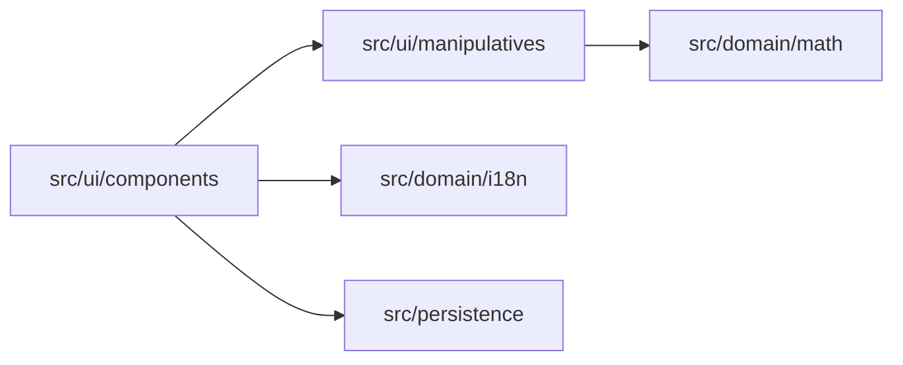

# Architecture Map

<!-- Agentic Delivery Standard v1.0 · tier: SEED (project-owned). Architecture for Learn GPT 2.0 -->

## 1. Context
- **System**: Learn GPT 2.0 — Interactive, visual, calm learning companion teaching 10-year-olds mathematics (geometry, set theory, multiplication, division, logic) through conceptual manipulatives, with English, Hindi, Telugu, Bengali, and Tamil localization.
- **Upstream systems**: None (Standalone client web application with privacy-first architecture)
- **Downstream systems**: Optional server-side AI proxy for guided conceptual hints (if enabled)
- **Runtime**: TypeScript, Modern Web (Vite / React or Vanilla), browser-native canvas/SVG/Web APIs for manipulatives, i18n for 5 languages.

## 2. Module map
| Module / folder | Concern (one) | Notes |
|---|---|---|
| `src/domain/math/` | Mathematical domain logic and evaluation | Pure: no framework, I/O, or UI imports |
| `src/domain/i18n/` | Multi-language translation & locale management | Pure: dictionaries for English, Hindi, Telugu, Bengali, Tamil |
| `src/ui/manipulatives/` | Interactive conceptual manipulatives (geometry, Venn, area model) | Presentation & input handling; uses domain models |
| `src/ui/components/` | Calm, non-gamey layout & navigation | Presentation only |
| `src/persistence/` | Local progress & configuration state | Local storage / IndexedDB |

## 3. Domain ownership (engineering invariant INV-1)
| Domain | Owning module | Rules document | Owner (team/person) |
|---|---|---|---|
| Mathematical Concepts & Validation | `src/domain/math/` | `docs/rules/MATH_RULES.md` | Core Team |
| Interactive Visual Manipulatives | `src/ui/manipulatives/` | `docs/rules/MANIPULATIVE_RULES.md` | Core Team |
| Multilingual Translations | `src/domain/i18n/` | `docs/rules/I18N_RULES.md` | Core Team |

A rule belongs to exactly one domain. If you cannot find the owner, stop and ask — do not create a second home.

## 4. Dependency rules (enforced by the `architecture-rules` check)
- `ui` → `domain`; `ui/manipulatives` binds user touch/click/drag to `domain/math`.
- `domain` must not import `ui`, frameworks, or DOM objects.
- All presentation text must resolve through `src/domain/i18n/`.
- Presentation displays values; it never computes domain mathematics.

## 5. Contracts and data
- Storage: Browser local storage (zero child personal data).
- Data classification: Public / Non-sensitive only.

## 6. Cross-cutting
- Logging: Console logger with debug levels.
- Security: Zero telemetry, zero analytics tracking, child privacy by default.

## 7. Where does new code go? (quick decision guide)
1. A mathematical rule or formula → `src/domain/math/`.
2. A visual interactive tool/widget → `src/ui/manipulatives/`.
3. A screen or layout → `src/ui/components/`.
4. Translated strings → `src/domain/i18n/`.
5. Shared utilities → only after a second real use (INV-2), in `src/shared/`.

## 8. Diagram

