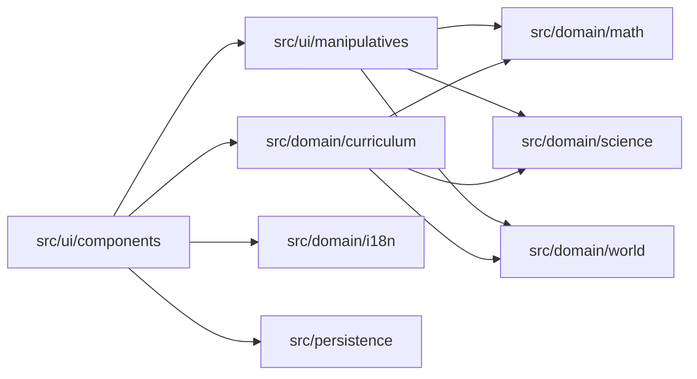

# Architecture Map

<!-- Agentic Delivery Standard v1.0 · tier: SEED (project-owned). Architecture for Learn GPT 2.0 (product name: Gurukul) -->

## 1. Context
- **System**: Gurukul (repository: Learn GPT 2.0) — Interactive, visual, calm learning companion for 10-year-olds (Class 5) across three Shalas: Ganita (mathematics), Vijnana (science) and Loka (social studies), taught through conceptual manipulatives, with English, Hindi, Telugu, Bengali, and Tamil localization. See ADR-0002 and ADR-0003.
- **Upstream systems**: None (Standalone client web application with privacy-first architecture)
- **Downstream systems**: Optional server-side AI proxy for guided conceptual hints (if enabled; not in scope for features 001–012)
- **Runtime**: TypeScript, Modern Web (Vite / React or Vanilla — decided at G2 of feature 001, see docs/product/DEV_HANDOFF.md §4), browser-native canvas/SVG/Web APIs for manipulatives, i18n for 5 languages.
- **Reference implementation**: `design/prototype/` (no-build JavaScript). It is the behavioural and visual reference to re-implement, not code to copy (docs/product/DEV_HANDOFF.md §5).

## 2. Module map
| Module / folder | Concern (one) | Notes |
|---|---|---|
| `src/domain/math/` | Mathematical rules: multiply, divide, geometry, kolam symmetry, sets, logic, number (place value, fractions, rupees and paise) | Pure: no framework, I/O, or UI imports |
| `src/domain/science/` | Vijnana rules: digestion order and absorption, friction and fair tests, light and shadow | Pure. Facts need a science teacher's sign-off (ADR-0002) |
| `src/domain/world/` | Loka rules: timelines (BCE/CE, no year zero), Earth's spin and seasons, maps (directions, blocking, scale) | Pure. Dates and facts need a social-studies teacher's sign-off |
| `src/domain/curriculum/` | Shalas, threads, knots, crossings (Jaal), lesson step order, and each lesson's content data (string keys, Bodha card ids, mistake and explain-back data) | Pure. May import the subject modules to name a rule; they never import it |
| `src/domain/i18n/` | Multi-language translation & locale management | Pure: dictionaries for English, Hindi, Telugu, Bengali, Tamil |
| `src/ui/manipulatives/` | Interactive conceptual manipulatives (area grid, fair share, rope, kolam, drums, courtyard, marbles, place houses, fraction strips, rupee grid, digestion path, ramp, lamp and stick, timeline, Earth, courtyard map) | Presentation & input handling; uses domain models |
| `src/ui/components/` | Calm, non-gamey layout, navigation, the lesson engine screens (Prashna, Bodha, film, workbench shell, mistake, explain, stop) | Presentation only |
| `src/persistence/` | Local progress & configuration state | Local storage / IndexedDB |

## 3. Domain ownership (engineering invariant INV-1)
| Domain | Owning module | Rules document | Owner (team/person) |
|---|---|---|---|
| Mathematical Concepts & Validation | `src/domain/math/` | `docs/rules/MATH_RULES.md` | Core Team |
| Science Concepts (Vijnana) | `src/domain/science/` | `docs/rules/SCIENCE_RULES.md` | Core Team + science teacher reviewer |
| Social Studies Concepts (Loka) | `src/domain/world/` | `docs/rules/WORLD_RULES.md` | Core Team + social-studies teacher reviewer |
| Curriculum Structure & Lesson Content | `src/domain/curriculum/` | `docs/rules/CURRICULUM_RULES.md` | Core Team + spec owner |
| Interactive Visual Manipulatives | `src/ui/manipulatives/` | `docs/rules/MANIPULATIVE_RULES.md` | Core Team |
| Multilingual Translations | `src/domain/i18n/` | `docs/rules/I18N_RULES.md` | Core Team |

The rules documents are created in DEV_HANDOFF Phase 0. A rule belongs to exactly one domain. If you cannot find the owner, stop and ask — do not create a second home.

## 4. Dependency rules (enforced by the `architecture-rules` check)
- `ui` → `domain`; `ui/manipulatives` binds user touch/click/drag to the domain modules.
- `domain` must not import `ui`, `persistence`, frameworks, or DOM objects.
- `domain/curriculum` may import `domain/math`, `domain/science` and `domain/world`; none of those three imports `domain/curriculum`.
- `domain/science` and `domain/world` may import `domain/math` through its public `index.ts` (for shared maths such as `gcd`); they never import each other, and `domain/math` imports neither.
- All presentation text must resolve through `src/domain/i18n/`.
- Presentation displays values; it never computes domain rules (maths, science or social studies).

## 5. Contracts and data
- Storage: Browser local storage (zero child personal data). Keys are listed in docs/product/DEV_HANDOFF.md §6.4.
- Data classification: Public / Non-sensitive only.

## 6. Cross-cutting
- Logging: Console logger with debug levels.
- Security: Zero telemetry, zero analytics tracking, child privacy by default. All secrets and environment variables are strictly managed in **Infisical** under project **`learn_gpt`**. Never store secrets locally or in git.

## 7. Where does new code go? (quick decision guide)
1. A mathematical rule or formula → `src/domain/math/`.
2. A science fact or rule (body, forces, light, materials) → `src/domain/science/`.
3. A history, geography or civics rule (dates, Earth, maps) → `src/domain/world/`.
4. Which lessons exist, their order, and their content data → `src/domain/curriculum/`.
5. A visual interactive tool/widget → `src/ui/manipulatives/`.
6. A screen or layout → `src/ui/components/`.
7. Translated strings → `src/domain/i18n/`.
8. Shared utilities → only after a second real use (INV-2), in `src/shared/`.

## 8. Diagram

