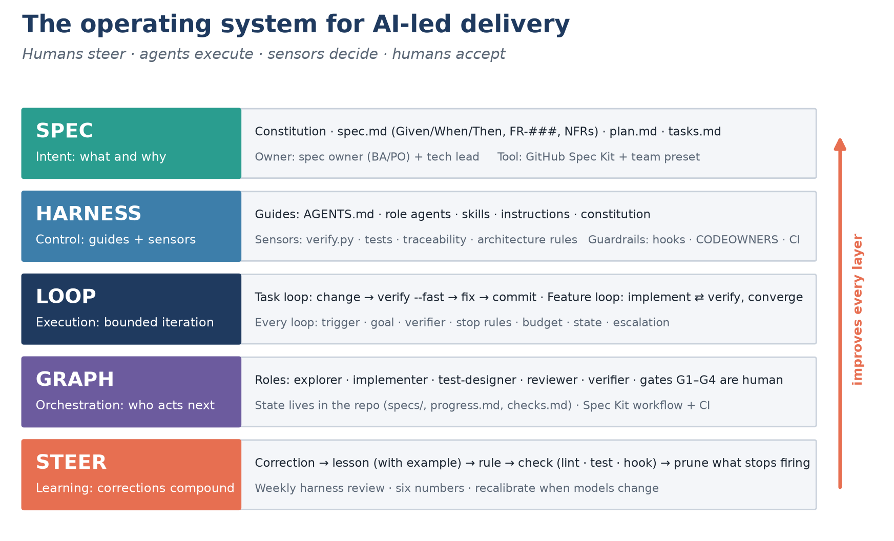
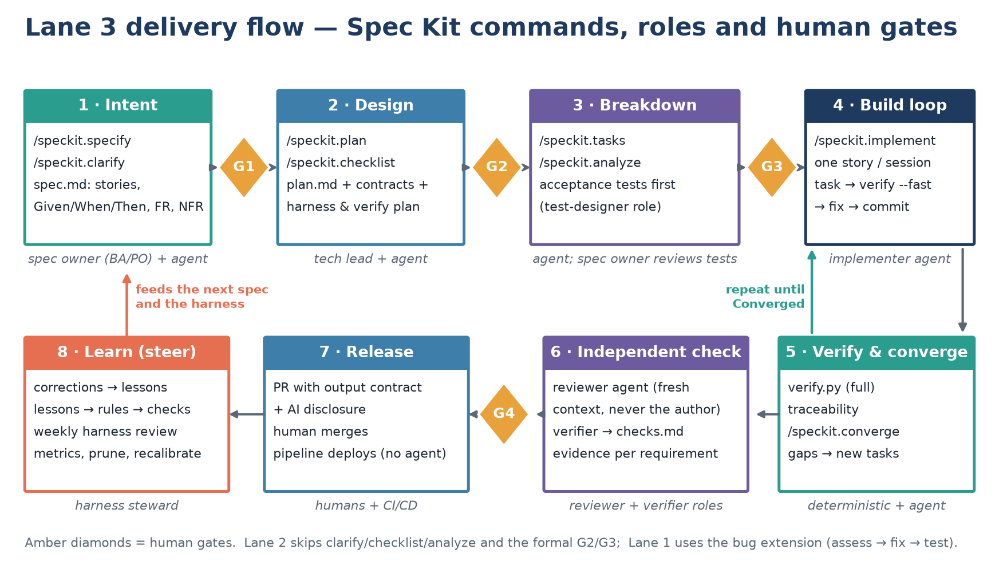
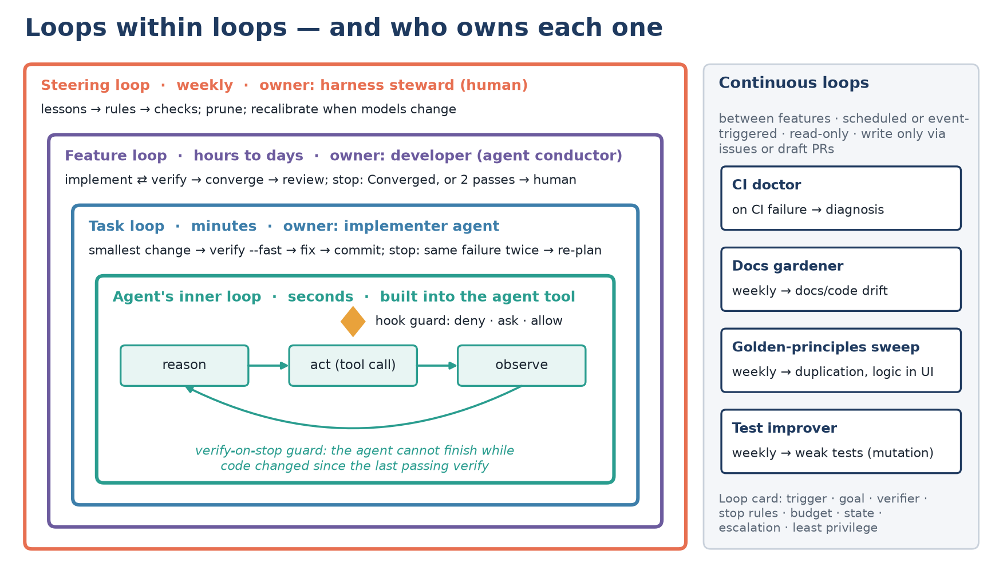

<!-- Agentic Delivery Kit v1.0.0 - the playbook in Markdown (same content as the Word edition). Figures in ./img. -->

# AI-Led Software Development Playbook

## Spec it · Harness it · Loop it · Graph it · Steer it

A best-practice process and system for delivering software with AI coding agents — built on GitHub Spec Kit, usable with GitHub Copilot and Claude Code, and packaged as a reusable standard for every project.

Prepared for: Karthik Kamalakar, DNE Content Systems · Version 1.0 · 8 October 2026
Companion deliverable: Agentic Delivery Kit v1.0.0 (templates, harness scripts, Spec Kit preset and workflow)

# 1. Executive summary

**The shift.** For five months the team has built apps by vibe-coding or from hand-written specs, steering agents turn by turn. The teams getting the most from AI coding agents in 2026 work differently: they stop prompting and start designing the *system* the agents work inside. OpenAI's harness team shipped a product of roughly a million lines with no hand-written code by redefining the engineer's job as "designing environments, specifying intent, and building feedback loops" — their summary is *humans steer, agents execute*. DORA's 2025 research adds the caution that matters for us: AI is an **amplifier** of whatever system it lands in — strong practices get stronger, weak ones get worse, faster.

**The answer in one picture.** This playbook defines a five-layer operating model, a right-sized process on GitHub Spec Kit with four human gates, and a standard harness that makes quality *enforceable* rather than hoped-for:

| Layer | Question it answers | What we put there |
|---|---|---|
| **Spec** (intent) | What exactly are we building, and how will we know it works? | Spec Kit constitution, spec.md with Given/When/Then scenarios and IDs, plan.md, tasks.md |
| **Harness** (control) | How do we make the agent likely to get it right, and catch it when it doesn't? | Guides (AGENTS.md, role agents, skills) · sensors (verify.py, tests, traceability, architecture rules, review) · guardrails (hooks, CODEOWNERS, CI) |
| **Loop** (execution) | How does work iterate to "done" without a human driving every turn? | Bounded loops with a verifier, stop rules, budget, state and escalation |
| **Graph** (orchestration) | Who — agent, script or person — acts next, with what state? | Roles, handoffs and gates G1–G4, encoded as a Spec Kit workflow |
| **Steer** (learning) | How does every correction make the next feature better? | Lessons → rules → automated checks; weekly harness review; metrics |

**What you get.**
1. An operating model and twelve design principles that reconcile your collected material with the wider evidence.
2. A right-sized process: five lanes (chore, bug, small change, feature, idea) plus a "spike" lane for vibe-coding that is never merged.
3. A Lane 3 feature flow on Spec Kit — *specify → clarify → plan → checklist → tasks → analyze → acceptance tests → implement ⇄ verify → converge → independent review* — with human gates G1 (spec ready), G2 (design ready), G3 (ready to build) and G4 (done).
4. A harness that turns rules into checks: one-command verification, requirement-to-test traceability, a test-integrity check that stops agents weakening tests, and hook guardrails that block destructive or secret-touching actions and force verification before an agent can finish.
5. A standard template kit (55 repository files, plus a Spec Kit preset and workflow) with a tier model: kit-managed **standard** files stay identical across projects; **seed** files become each project's own.
6. Roles, cadence, metrics and a 12-week rollout with an autonomy ladder.

**A realistic promise.** "Complete the design and requirements up front, then agents build to a very high quality" is achievable — on three conditions this system is built around: (1) intent is *executable* — acceptance scenarios become tests that a human reviews before implementation; (2) quality is *enforced by sensors*, not requested in prose; (3) discoveries during build flow back into the spec through a controlled path instead of silently diverging. It is not waterfall: every user story is an independently testable slice, and the spec evolves under change control.

> **The ten non-negotiables:** (1) No feature code without an approved spec and plan. (2) Every requirement and scenario has an ID and a test (or recorded manual evidence). (3) Acceptance tests are written before implementation and reviewed by the spec owner. (4) "Done" means verify.py passed in this session — evidence, not claims. (5) Nobody weakens, skips or deletes tests to get green. (6) Smallest sufficient change; refactor first, then change. (7) Business rules live in one owning module. (8) The agent that builds never judges its own work. (9) Humans own irreversible actions: merge, release, delete, secrets, spend. (10) Every correction becomes a lesson, and every repeated lesson becomes a check.

# 2. What your collected material says

The Learn_AI › Docs › Coding_Best folder contains six practitioner artefacts and one research paper. They converge strongly — plan before typing, smallest change, split work by job, verify with evidence, record corrections — and each one maps into a specific part of the system.

| Source in your folder | Key ideas worth keeping | Where it lands in the system |
|---|---|---|
| **Agents_3.md** — design principles and hard invariants | Separation of concerns, encapsulation, DRY with judgment, KISS/YAGNI, depend on contracts; invariants: one owning module per domain, never duplicate logic (move → switch → reuse), no business logic in rendering; *refactor first, then change*; **"Gates, not promises — a rule that matters is enforced by CI or a hook."** | docs/standards/ENGINEERING_PRINCIPLES.md (INV-1…INV-6 with an enforcement map), AGENTS.md §5, constitution Article V, `refactor-safely` skill |
| **AGENTS.md shared by Codex and Claude Code** (two images) | Plan before code (PLAN.md; two failed tries → re-plan); smallest change; subagents with one job, done-condition and 5-line report; own the bug (reproduce first); verify before done (break the UI); write down every correction; **"lead with what you need from me"** | AGENTS.md §3, §6–§8; output contract item 0 "Needs from you"; progress.md handoff; lessons.md |
| **Workflow-orchestration card** | Plan mode for any non-trivial task; subagents to keep context clean; self-improvement loop (lessons.md); verification before done ("would a staff engineer approve this?"); demand elegance — *balanced*; autonomous bug fixing; tasks/todo.md | Lane selection, role agents, skills `verify-change` and `capture-lesson`; Spec Kit tasks.md replaces todo.md; "demand elegance" lives in the simplicity article and the reviewer checklist |
| **"Senior engineer" AGENTS.md** (XML-tagged sections) | Seven-step workflow (restate, survey, plan, delegate, execute, verify, record); "done" = it ran, it's scoped, it's reversible, it's readable; error-correction rules; context discipline; handoff contract; self-improvement with examples; output contract; anti-patterns; gates; **six numbers to track**; install the file over five days | AGENTS.md backbone (§3, §6, §7, §9, §10, §12); metrics (section 13); rollout plan ("a file written in one sitting is a file nobody follows") |
| **Scope Guard** | Check existing code → standard library → installed dependencies → new code; fix root cause; no speculative layers; ask only for material scope, cost or irreversible actions; "done means" | AGENTS.md §4 and §10; Definition of Done |
| **Karpathy-inspired harness prompt** (by @beamnxw, adapted from Karpathy's autoresearch — not written by Karpathy) | Define completion before starting; baseline first; **fixed evaluator**; keep improvements, record failures; seven layers (context, procedure, tools, permissions, review, effort, completion); "prose alone is not a boundary"; checks.md (requirement · verdict · evidence · correction); progress.md handoff | verify.py as the fixed evaluator; baseline verify at session start; checks.md and progress.md templates; hooks for permissions; separate reviewer |
| **Harness Engineering paper** (Barbaste et al., arXiv 2609.00006, July 2026 — source study of 11 coding harnesses) | Agent = model + harness; seven subsystems; policy is migrating from prompt prose to configuration; hierarchical Markdown context files everywhere; skills for procedures, MCP for integrations; single agent until a breadth-first phase justifies more; codify safety as data with a floor; cheap stop caps; no code RAG, no agent frameworks; verify-on-stop guards; human-gated memory inboxes | We are harness *users*: we configure the outer harness with context files, skills, hooks and sensors; `agent_hooks.py` is policy-as-data with a floor; the verify-on-stop guard; lessons.md as a human-gated memory inbox; subagents mainly for exploration and review |

**What the collection does not yet cover** — and this playbook adds: a link from requirements to tests (traceability); mechanical enforcement of most rules (they are prose); a team-level process with roles and gates; security beyond "ask before sending"; measurement at team level; and integration with Spec Kit as the shared process.

# 3. What the wider evidence says

Independent research (October 2026) confirms the direction of your material and adds five things.

**3.1 Spec Kit has become a process toolkit, not just templates.** Spec Kit 1.1 (October 2026) offers three processes — Spec-Driven Development in core, plus bug fixing (*assess → fix → test*) and idea assessment (*intake → research → define → shape → decide*) as bundled extensions. The SDD path is *constitution once; specify → plan → tasks → implement → converge per feature*, with clarify, checklist and analyze as quality gates for production work, and **converge** (new) re-assessing the code against the artefacts and appending tasks until the feature has converged. Customisation is layered: *extensions* add capabilities, *presets* change templates and command prompts (stackable, with replace/prepend/append/wrap composition), *workflows* automate multi-step processes with gates, loops and resumable state, and *bundles* package a role-based setup; organisations can host their own catalogs. Spec Kit's own team uses it selectively: small fixes go through normal issue/PR flow, releases run on deterministic pipelines without an agent, and maintainers — not agents — decide to proceed or merge.

**3.2 Spec-driven development has known failure modes — design for them.** Thoughtworks' Birgitta Böckeler found that one workflow does not fit all problem sizes (a small bug became 4 user stories and 16 acceptance criteria), that reviewing many generated Markdown files can be more tedious than reviewing code, and that elaborate instructions create a *false sense of control* because agents still ignore or over-apply them. This playbook answers each: lanes right-size the process; specs stay short and behavioural; and rules that matter are enforced by sensors, not by more prose.

**3.3 Harness engineering is the discipline that makes agents trustworthy.** Böckeler's model (April 2026) splits every control into **guides** (feed-forward: steer before the agent acts) and **sensors** (feedback: let it self-correct), each either **computational** (tests, linters, type checks — cheap, deterministic) or **inferential** (AI review, LLM-as-judge — richer, probabilistic). The human's job becomes the *steering loop*: when an issue recurs, improve the guides and sensors. She names three regulation areas — maintainability, architecture fitness and **behaviour**, the last being the least solved because AI-generated tests are not trustworthy enough on their own. OpenAI's harness team adds concrete practice: AGENTS.md as a ~100-line *table of contents* into a structured docs/ tree, the repository as the system of record ("if the agent can't see it, it doesn't exist"), architecture enforced by custom linters whose error messages teach the fix, and recurring "garbage collection" agents that open small clean-up PRs. (Their figures — ~1M lines, ~1,500 PRs, ~1/10th of the time — are vendor-reported.)

**3.4 Long-running work needs state outside the model and an independent judge.** Anthropic's long-running harness uses an initializer session that sets up the environment, then coding sessions that each make incremental progress on one feature, read a progress file and git history at start, test end-to-end, and leave clean artefacts for the next session. Their later application-development harness separates a planner, a generator and an **evaluator**, because agents asked to grade their own work "confidently praise" it; in one comparison a solo run cost about $9 and produced a broken app while the full harness cost about $200 and produced a working one. They also remove scaffolding as models improve — every harness component encodes an assumption about what the model cannot do.

**3.5 Loops and graphs are names for designing the system that prompts the agent.** "Loop engineering" (popularised by Addy Osmani, June 2026) means building a system that finds work, hands it out, checks it, records what is done and decides the next step — with deterministic finish lines (e.g. Claude Code's `/goal … stop after 5 tries`), budgets, and a verifier that is not the generator. "Graph engineering" (July 2026) extends this to coordinating several loops, deterministic steps and humans with explicit state, gates and failure paths. Sceptics note it is largely workflow orchestration renamed, that graphs contain loops, and that most tasks need one loop with one verifier; the most useful principle from the debate is that **code should control predictable routing while models handle judgment**. We adopt exactly that: the delivery graph is a Spec Kit workflow with human gates; agents do the judgment inside nodes.

**3.6 Supporting facts that shape the design.**
- **AGENTS.md is the cross-tool standard** (stewarded by the Linux Foundation's Agentic AI Foundation, used by 60,000+ projects; nested files apply to their subtree). Copilot's coding agent reads root and nested AGENTS.md; Copilot Chat on github.com reads only `.github/copilot-instructions.md`; Claude Code (from 2.1.277, September 2026) reads AGENTS.md only when no CLAUDE.md exists — so the kit's CLAUDE.md simply imports `@AGENTS.md`.
- **Test-first inside the agent's own loop showed no clear benefit** in Böckeler's small evaluation (August 2026), whereas human-written or human-reviewed tests act as an independent specification. We therefore put the human checkpoint on acceptance tests and measure unit-test quality by outcome (mutation testing).
- **Agentic automation is safest read-only.** GitHub Agentic Workflows run agents read-only and route every write through validated "safe outputs"; their guidance warns against the *lethal trifecta* — private data, untrusted content and outbound access in one agent.
- **DORA 2025**: the value of AI comes from the surrounding system — capabilities including a clear AI policy, a healthy data ecosystem, a quality internal platform and a user-centric focus.

# 4. Design principles

1. **Humans steer, agents execute, sensors decide, humans accept.** Human time and attention are the scarce resource; spend them on intent, trade-offs and acceptance — not on typing code or re-checking what a sensor can check.
2. **Intent before implementation — right-sized.** Specs are the agents' source of intent, but a typo fix doesn't need four user stories. Choose the lane first.
3. **If the agent can't see it, it doesn't exist.** Decisions, architecture, conventions and rules live in the repository. AGENTS.md is a map, not an encyclopedia.
4. **Gates, not promises.** A prompted "never" protects nothing. Rules that matter become tests, lint rules, hooks or CI checks.
5. **Evidence, not claims.** Done means it ran, it's scoped, it's reversible and it's readable. An unrun check is not a pass.
6. **Separate making from judging.** The builder never reviews its own work; reviewers and verifiers start from a fresh context.
7. **Small, reversible, single-concern changes.** One concern per commit; refactor first, then change behaviour.
8. **Bounded loops.** Every loop has a deterministic finish line, stop rules, a budget, durable state and an escalation path.
9. **Constrain the solution space.** One owning module per domain, standard topologies, a known stack — a narrower space is a more governable one.
10. **Keep quality left.** Fast sensors inside the agent loop; heavier ones in CI; drift sensors on a schedule.
11. **Least privilege; humans own the irreversible.** Merge, release, delete, secrets, access and spend stay with a person.
12. **Corrections compound.** Every correction becomes a candidate lesson; repeated lessons become checks; rules that stop firing are removed; the harness is re-tested when models change.

# 5. The operating model

*Figure 1 — The five layers of the operating model and how steering improves every layer*

**Spec (intent).** The Spec Kit constitution captures the project's non-negotiable principles once; each feature then gets a spec.md (what and why — user stories with priorities, Given/When/Then scenarios, functional requirements with IDs, measurable NFRs, scope boundaries), a plan.md (how — architecture, contracts, data model, and the harness and verification plan) and a tasks.md (steps — small, verifiable, test-first). The team preset adds the sections agents most often need but specs usually omit: *must-not-change* items, measurable NFRs, integration contracts, testing requirements and gate checklists.

**Harness (control).** Guides make good output likely: AGENTS.md (the map), role agents, skills (procedures), path-specific instructions and the standards documents. Sensors catch what slips through: `verify.py` runs the project's checks in one command; `check_traceability.py` proves every requirement and scenario has a test; `check_test_integrity.py` blocks weakened tests; architecture rules enforce ownership; the reviewer and verifier roles add judgment. Guardrails keep humans in charge: hooks deny dangerous actions and ask before protected changes, CODEOWNERS routes harness and spec changes to their owners, and CI makes the sensors mandatory.

**Loop (execution).** The agent's own reason-act-observe loop sits inside a task loop (smallest change → fast verify → fix → commit), inside a feature loop (implement ⇄ verify → converge → independent review), inside the weekly steering loop. Each loop has a verifier that is not the generator and stop rules that hand control back to a person.

**Graph (orchestration).** Work moves between agent roles, deterministic checks and human gates. State lives in the repository — specs/, progress.md, checks.md, git history — never only in a chat. The Lane 3 graph is encoded as a resumable Spec Kit workflow (`agentic-sdd`), so the process is the same for everyone.

**Steer (learning).** Corrections are captured as candidate lessons with examples, reviewed weekly, promoted to rules and — preferably — to automated checks. Six numbers tell you whether the system is improving.

# 6. Right-sizing: choose the lane first

| Lane | Use when | Process | Human touchpoints | Typical artefacts |
|---|---|---|---|---|
| **0 · Chore** | Typos, config, dependency bumps, docs, mechanical refactors with no behaviour change | Issue → agent (IDE, CLI or Copilot coding agent) → PR with verify evidence | PR review | PR only |
| **1 · Bug** | Existing behaviour is wrong | Spec Kit bug extension: assess → fix → test; failing reproduction test first | Accept the assessment; PR review | .specify/bugs/<slug>/ reports, regression test |
| **2 · Small change** | One module, low risk, roughly ≤ 2 days of human-equivalent work | Lean SDD: specify → plan → tasks → implement → converge | G1 (light), G4 | spec.md, plan.md, tasks.md, checks.md |
| **3 · Feature** | Cross-module work, new data or integrations, external contracts, security- or money-relevant behaviour | Full SDD with all quality gates (section 7), optionally via the `agentic-sdd` workflow | G1, G2, G3, G4 | Full feature folder incl. contracts/, progress.md, checks.md, review.md |
| **4 · Idea** | Value or feasibility unclear | Spec Kit assess extension: intake → research → define → shape → decide | Go / clarify / kill decision | .specify/assessments/<slug>/ |
| **Spike** | You need to learn fast (UI feel, API behaviour, performance) | Vibe-code on a throwaway branch or sandbox; capture the learning in a spec | Decide what goes into the spec | Notes and screenshots — **the code is never merged** |

> **Rule — vibe to learn, spec to build.** Vibe-coding stays valuable for discovery. Its output is knowledge that improves the spec, not code that reaches main.

**Lane selection tips.** If you can't state the change and its proof in three lines, it isn't Lane 0. If two modules or an external contract change, it's Lane 3. When unsure between 2 and 3, choose 3 for the first feature in a new area and 2 once the area is well harnessed. Bugs that reveal a missing requirement become a Lane 2 or 3 change after the fix.

# 7. The end-to-end process (Lane 3)

*Figure 2 — The Lane 3 flow: Spec Kit commands, roles and human gates G1–G4*

| Phase | Purpose | Spec Kit / kit commands | Who | Exit criteria (gate) |
|---|---|---|---|---|
| **0 · Foundation** (once per repo) | Make the repository agent-ready | `specify init`, install kit, `specify preset add agentic-delivery`, `/speckit.constitution`, `harness_doctor.py`, `verify.py` | Tech lead + harness steward | Doctor has no FAIL; verify passes on main; Quality Gates required in branch protection |
| **1 · Intent** | Capture what and why, testably | `/speckit.specify`, `/speckit.clarify` | Spec owner (BA/PO) with the agent; developer consulted | **G1 Spec Ready**: no open clarifications; each FR testable; Given/When/Then incl. negative cases for every story; NFRs measurable; scope and must-not-change explicit |
| **2 · Design** | Decide how, and how it will be proven | `/speckit.plan`, `/speckit.checklist`; explorer role for reuse; ADRs | Tech lead with the agent | **G2 Design Ready**: constitution check passes; owning modules reused; contracts and data model; harness and verification plan; new dependencies justified; rollback known |
| **3 · Breakdown** | Turn design into small, verifiable tasks; write acceptance tests first | `/speckit.tasks`, `/speckit.analyze`; test-designer role | Agent; spec owner reviews P1 acceptance tests | **G3 Ready to Build**: analyze shows no CRITICAL/HIGH; every FR and scenario maps to tasks and tests; acceptance tests express the intended behaviour and fail for the right reason |
| **4 · Build** | Implement one user story per session | `/speckit.implement`; implementer role; `verify.py --fast` per task | Agent; developer as conductor | Story checkpoint: full verify and traceability pass; checks.md and progress.md updated |
| **5 · Verify & converge** | Prove the feature matches its artefacts | `verify.py`, `check_traceability.py --strict`, `/speckit.converge` (repeat until Converged; max two automatic passes) | Deterministic checks + agent | Converged; no open tasks |
| **6 · Independent check** | Judge with fresh eyes | reviewer role (fresh context, never the author); verifier role fills checks.md | Agents; developer reads results | **G4 Done**: no unresolved BLOCKER/MAJOR; every requirement has PASS evidence or approved manual verification |
| **7 · Release** | Merge and ship deterministically | PR with output contract + AI disclosure; pipeline deploys | Humans (merge); CI/CD | Required checks green; CODEOWNERS approvals; post-release checks green |
| **8 · Learn** | Make the next feature better | `capture-lesson` skill; harness-steward role; weekly review | Harness steward | Lessons triaged; at least one rule turned into a check when a pattern repeats |

## 7.1 Writing specs agents can build from

A good spec is short, behavioural and testable. The BA team owns this craft; it is the highest-leverage skill in the whole system.
- **User stories are independently valuable slices**, prioritised P1, P2, P3. Each can be built, tested and demonstrated on its own.
- **Scenarios use Given/When/Then and are numbered** under each story; their IDs (`US1-AS2`) are derived automatically and appear in test names. Include at least one negative or edge case per story.
- **One behaviour per requirement**, written as "System MUST …" with an ID (`FR-007`). No technology, frameworks or code.
- **NFRs carry numbers** (p95 latency, volumes, retention, accessibility level). Unknowns are marked `[NEEDS CLARIFICATION]`, never guessed.
- **Must-not-change** lists the existing behaviour, APIs and data that must stay as they are — each becomes a regression test.
- **Examples beat adjectives**: sample payloads, files and screens become approved fixtures.
- **Out of scope is explicit** — agents over-deliver on under-specified requests.

## 7.2 When the spec turns out to be wrong

Discoveries are normal; silent divergence is not. Spec Kit documents three persistence models; we use them deliberately:

| Model | Use for | How it works |
|---|---|---|
| **Living spec** | Core domain capabilities (e.g. scheduling, ingest and component rules) | spec.md is the contract for the capability over time. Change spec.md first (with spec-owner approval), then regenerate or revise plan and tasks, then `/speckit.analyze`. |
| **Flow-forward** | Most features | Each feature folder is a historical record; a follow-up change gets a new feature spec that references the old one. |
| **Flow-back** | Exploratory work inside an approved feature | Capture the discovery where it lands, then bring spec, plan and tasks back into agreement and run `/speckit.analyze` before continuing. |

During implementation agents never edit acceptance scenarios or acceptance tests; they record the question in progress.md, and the test-integrity check blocks the PR until a human approves the change.

# 8. The harness: guides, sensors and guardrails

## 8.1 What we use, by type

| | Computational (deterministic) | Inferential (AI judgment) | Human |
|---|---|---|---|
| **Guides** (before the agent acts) | Project templates, the Spec Kit preset, typed contracts and schemas, code generators | AGENTS.md, role agents, skills, path instructions, constitution, ARCHITECTURE.md, ADRs | Spec, scenarios, design decisions |
| **Sensors** (after the agent acts) | `verify.py` (format, lint, types, unit, acceptance, contract, architecture rules), traceability, test integrity, secret and dependency scans, mutation testing | `/speckit.analyze`, `/speckit.converge`, reviewer and verifier roles, Copilot code review | Gate reviews, acceptance-test intent review, PR review, UI acceptance |
| **Guardrails** (limits on action) | Hooks (deny / ask), branch protection, required checks, least-privilege tokens, sandboxes | — | CODEOWNERS approvals, merge and release decisions |

## 8.2 Keep quality left: when each sensor runs

| Moment | What runs | Cost | Purpose |
|---|---|---|---|
| Before acting | Session-start hook injects the protocol; agent reads AGENTS.md, spec, plan, progress.md | Seconds | Right context, right lane |
| Every tool call | Pre-tool hook: deny destructive or secret-touching commands; ask before dependency adds or protected-file edits | Milliseconds | Prevent irreversible mistakes |
| Every task | `verify.py --fast` (format, lint, types, unit tests) | Seconds–minutes | Fast self-correction |
| Before finishing | Verify-on-stop hook: the agent cannot end its turn while code changed since the last passing verify | Seconds | Evidence before claims |
| Story checkpoint | `verify.py` full + traceability | Minutes | Story-level proof |
| Pull request | Quality Gates CI: verify, traceability, test integrity, secrets, dependency review; reviewer role | Minutes | Independent, mandatory proof |
| Nightly / weekly | Mutation testing, full end-to-end, docs-drift and golden-principles sweeps | Hours | Catch slow drift |

## 8.3 The behaviour harness — the hardest part, made explicit

Linters and type checkers catch structure; only tests and acceptance evidence catch wrong behaviour. Our behaviour harness has six parts:
1. **Human-owned scenarios** in the spec, with IDs.
2. **Acceptance tests written first** by the test-designer role, one per scenario, named with the scenario ID — and **reviewed by the spec owner at G3**. This is the checkpoint the evidence supports.
3. **Traceability as a sensor**: `check_traceability.py` fails when a requirement or scenario that is claimed done has no test. It is progressive (stories you've started, IDs in ticked tasks) during the build and strict at convergence.
4. **Protection**: existing acceptance tests are protected by the pre-tool hook (agents must ask), by CODEOWNERS (spec owners approve) and by `check_test_integrity.py` (deleted tests, new skips or `.only`, edited acceptance tests and removed scenarios fail the PR unless a human adds the `approved-test-change` label).
5. **Approved fixtures** for complex outputs (reports, payloads, transformations): agents propose; humans approve every golden-file diff.
6. **Outcome measures**, not ritual: changed-line coverage and weekly mutation scores on core domain modules.

## 8.4 Guardrails in practice

| Agent tries to … | Guard decision | Why |
|---|---|---|
| `git push --force`, push to main/release, `--no-verify`, rewrite history | **Deny** | Shared history and bypassing the harness are human decisions |
| `rm -rf` on root/home/parent/.git, `Remove-Item -Recurse` on the same | **Deny** | Irreversible |
| Read `.env`, keys or credential files; dump environment variables; print tokens | **Deny** | Secret exposure |
| `curl … \| sh`, `iwr … \| iex` | **Deny** | Unreviewed remote code |
| Publish packages, deploy (terraform apply, kubectl apply, helm upgrade), merge PRs | **Deny** | Release is a pipeline and human decision |
| Add a dependency (`npm install <pkg>`, `pip install <pkg>`, `dotnet add package`) | **Ask** | Constitution Article IV: justify and approve |
| Edit AGENTS.md, CI, hooks, agent settings, constitution, standards; edit an existing acceptance test | **Ask** | Agents must not loosen their own constraints or the contract |
| `git reset --hard`, `git clean -f`, `git rebase` | **Ask** | Destroys or rewrites work |
| Finish a turn with code changed since the last passing verify | **Sent back** (max twice) | Verify before done |

"Ask" means a human approves in interactive sessions; in the Copilot cloud agent nobody is present, so "ask" becomes "deny". The guard fails *open* on its own internal errors so it can never brick an agent — CI is the backstop. Projects tune it in `harness.toml` rather than editing the script.

## 8.5 Harnessability — make the codebase easy to govern

Agents succeed more often in codebases that make the right thing easy: strict typing; clear module boundaries with an ownership map; one-command setup and a fast, deterministic test suite; the app bootable locally (or per worktree) so agents can exercise it; structured logs they can read; and examples of the patterns you want. `harness_doctor.py` scores each repository on these. Greenfield projects can build harnessability in from day one; legacy projects need it most and should start by making `verify.py` green on current code before agents build anything new.

**Harness templates.** As patterns settle, keep one kit variant per service topology the team builds repeatedly — for example *API service*, *integration/middleware service*, *reporting/data* and *web UI* — each with the stack's real commands, architecture rules and test layout pre-filled.

# 9. Loops

*Figure 3 — Loops within loops, their owners, and the continuous loops that run between features*

## 9.1 The loop card — fill it in before automating anything

| Element | Question | Our default |
|---|---|---|
| Trigger | What starts it? | Human (task, feature), event (CI failure, PR), schedule (weekly) |
| Goal | What does done look like — as an exit code? | `verify.py` exits 0; traceability strict has no MISSING; Converged |
| Verifier | Who checks — and is it independent of the generator? | Deterministic checks first; reviewer role in a fresh context second |
| Stop rules | When does it give up? | Same failure twice; scope growth; two converge passes; three blocked tasks |
| Budget | How much may it spend? | Iteration cap plus a token/cost cap per run (set in the tool) |
| State | Where does it remember progress? | tasks.md, progress.md, checks.md, git history, issue labels |
| Escalation | Who gets what when it stops? | The owner, with the failing output and the next proposed action |
| Privilege | What may it change? | Feature branch only; outward writes via draft PRs or issues |

## 9.2 Loops we run

- **Task loop** (implementer): smallest change → `verify.py --fast` → fix → tick → commit. Stop on the same failure twice.
- **Feature loop** (developer as conductor): `/speckit.implement` per story → verify → `/speckit.converge` → repeat until Converged, at most two automatic passes → independent review. In Claude Code, `/goal python scripts/harness/verify.py exits 0 — stop after 5 attempts` is a good bounded inner driver; with Copilot, assign well-specified Lane 0–1 issues to the coding agent and let the hooks and Quality Gates hold the line.
- **PR loop**: respond to review and CI comments until reviewers are satisfied — bounded to a set number of rounds before escalating to a person.
- **Continuous loops** between features: CI doctor, docs gardener, golden-principles sweep, test improver (loop cards in the kit's optional folder). Start **report-only** for two weeks, then allow draft PRs. Build them with GitHub Agentic Workflows (read-only agents, safe outputs) or scheduled jobs.
- **Steering loop** (weekly, human-owned): review lessons, hook logs, review findings and the six numbers; promote, automate or prune.

> **Rule — cost discipline.** Loops multiply token spend. Every automated loop has an iteration cap and a budget, logs its runs, and is retired if its findings are ignored for a month.

# 10. The graph: roles, handoffs and gates

## 10.1 Agent roles (defined once in the kit, for both Copilot and Claude Code)

| Role | Does | Never | Returns |
|---|---|---|---|
| **explorer** | Finds the owning module, reusable code, affected callers and risks | Edits or decides scope | ≤ 15 lines with file:line evidence |
| **implementer** | Executes one task; smallest change; verify; tick; commit | Decides scope; edits acceptance tests or harness files | Output contract with verify evidence |
| **test-designer** | Writes acceptance tests from scenarios before implementation; proves they fail for the right reason | Writes production code | Tests → scenario IDs, failing-run evidence, questions |
| **reviewer** | Reads the diff cold against spec, plan, constitution and checklist; re-runs checks | Edits; reviews its own work | Verdict and evidence-backed findings by severity |
| **verifier** | Records a verdict with observed evidence for every requirement in checks.md | Marks PASS without evidence; edits code | PASS/FAIL/UNRESOLVED counts and gaps |
| **harness-steward** | Turns recurring mistakes into checks or precise rules; prunes guidance | Builds features | Proposal table: problem → evidence → control → cost |

**Handoff contract** (every delegation): the task in one line; the inputs it already has; what counts as done; what was tried and failed; who owns the next step if the chain stops. **Return contract**: evidence, not effort.

## 10.2 When to use more than one agent

Use subagents for **breadth-first exploration** (parallel codebase research), for **independent judgment** (review, verification) and for **parallel user stories in separate worktrees** that touch different files. Do not run several agents on the same files, and do not build "agent swarms" without explicit state and gates — agents checking agents can produce organised nonsense at scale unless some evidence comes from outside the system (tests, real users, people). Multi-agent runs also cost several times more tokens; justify them by a breadth-first phase or an independence requirement.

## 10.3 The graph as a workflow

The kit's `agentic-sdd` Spec Kit workflow encodes the Lane 3 graph: command and prompt nodes for agent work, shell nodes for deterministic checks, gate nodes for G1–G4, and a bounded retry branch after convergence. Runs pause at every gate and resume from the exact step (`specify workflow resume <run_id>`), which gives an audit trail of who approved what and when. Code routes; models judge; people decide.

# 11. Context engineering

- **AGENTS.md is the map** (≤ 150 lines): project map, real commands, the seven-step workflow, scope guard, invariants, verification, gates, security, output contract, promoted lessons. Detail lives in docs/ and is linked.
- **Hierarchy**: the nearest AGENTS.md wins for files beneath it — use nested files for module-specific rules; use `.github/instructions/*.instructions.md` with `applyTo` for file-type rules (tests, specs).
- **Tool pointers, not copies**: CLAUDE.md imports `@AGENTS.md`; `.github/copilot-instructions.md` is a short pointer plus the eight non-negotiables for surfaces that don't read AGENTS.md.
- **Session protocol**: read AGENTS.md, then the active feature's progress.md, spec, plan, open tasks and recent git log; run a baseline verify; never build on red.
- **One user story per session; prefer resets to long compactions.** Before context gets heavy, update progress.md (task, completed with evidence, decisions, open questions, failed attempts, next action) and start fresh.
- **Search before loading**: grep, glob and language servers beat loading folders; quote the line you relied on.
- **Skills over prompts**: recurring procedures (verify, reproduce a bug, write acceptance tests, refactor safely, handoff, capture a lesson) live as skills so they load only when relevant.

# 12. Safety and governance

| Concern | Control |
|---|---|
| Destructive or irreversible actions | Hook deny-list; branch protection; deploys only via pipelines; humans merge |
| Secrets | Hooks block reads and env dumps; secret scanning in pre-commit and CI; short-lived scoped tokens; never secrets in prompts |
| Prompt injection | Issue text, comments, web pages and logs are data, not instructions; outward actions are gated; agentic workflows run read-only with safe outputs |
| The lethal trifecta | Never give one autonomous agent private data + untrusted content + outbound access; split the work or sandbox egress |
| Autonomy | Interactive "plan" and "default" modes on laptops; auto-approve modes only inside containers, devcontainers, Codespaces or the cloud agent sandbox |
| Supply chain | Dependency adds need approval; verify packages exist and are reputable; skills, MCP servers, Spec Kit extensions/presets/workflows installed only from an approved internal catalog after code review (community catalogs are not audited) |
| Accountability | CODEOWNERS on harness, specs and acceptance tests; agent commits carry a co-author trailer; every PR discloses tool, model, mode and extent of AI assistance |
| Data handling | Follow the organisation's AI acceptable-use and data-classification policy (linked from PROJECT_RULES.md); synthetic test data only |

# 13. Roles, responsibilities and cadence

| Role | Owns | Key moments |
|---|---|---|
| **Spec owner** (BA / product owner) | spec.md, scenarios, clarifications, acceptance | Writes and approves at G1; reviews acceptance-test intent at G3; accepts at release |
| **Tech lead / architect** | Constitution, ARCHITECTURE.md, plan approval, harness evolution, protected files | Approves G2 and G4; owns CODEOWNERS for harness files |
| **Developer — agent conductor** | Running the loops, curating context, reading evidence, fixing harness gaps | Drives Phases 3–6; never merges unverified work |
| **Verification lead** (QA or reports developer) | Test strategy, approved fixtures, end-to-end checks, mutation and coverage trends | Reviews acceptance tests with the spec owner; watches escaped defects |
| **Harness steward** (rotating, weekly) | Lessons, hook logs, sensor backlog, AGENTS.md hygiene | Runs the 30-minute weekly harness review |
| **Delivery lead** (you) | Lanes, priorities, metrics, autonomy levels, rollout | Monthly recalibration; approves autonomy-level changes |

**RACI for gates.** G1: spec owner (A/R), developer (C), tech lead (C). G2: tech lead (A/R), developer (R), spec owner (C). G3: tech lead (A), spec owner (R for test intent), developer (R). G4: tech lead (A), developer (R), verification lead (C), spec owner (I, then accepts the outcome).

**Fit with your team.** The team's mix — several business analysts alongside developers, a reports developer and an implementation consultant — suits spec-driven delivery well: BAs naturally own Phase 1 and the G1/G3 reviews, developers own design, harness and loops, the reports developer is a natural verification lead for data-heavy outputs, and the implementation consultant can own environments, runbooks and the release checklist. Invest early in BA training on Given/When/Then, measurable NFRs and must-not-change lists: in this system spec quality sets the ceiling for agent quality.

**Cadence.** Per feature: spec review (30–60 min), design review (30 min), acceptance-test review (15–30 min), PR review focused on evidence. Weekly: harness review (30 min). Monthly: recalibration — re-run a small set of "golden tasks" with the current models and harness, remove scaffolding that no longer earns its place. Quarterly: release a new kit version.

# 14. Measuring success

| Category | Metric | Why |
|---|---|---|
| Delivery (DORA) | Lead time (spec approved → merged), deployment frequency, change failure rate, recovery time, rework rate | Are we delivering more, safely? |
| Quality | Escaped defects per feature; traceability coverage; mutation score on core modules | Is the behaviour harness working? |
| Agent effectiveness | First-pass verify rate; converge passes per feature; tasks blocked per session | Are specs and harness good enough for agents to succeed? |
| Human attention | Review minutes per PR; escalations per feature (and their trend) | Is human time going to the right places? |
| Harness health | Rules kept vs proposed; repeat errors (same failure in two different weeks); hook denials by type; silent runs | Is the system learning — or accumulating decoration? |
| Cost | Tokens or currency per feature, per loop, per month | Are loops paying for themselves? |

> **The six numbers to watch weekly** (from your collected AGENTS.md): rework you had to redo yourself · escalations and whether they fall · repeat errors · rules kept versus proposed · silent runs that produced nothing and said nothing · cost per task, day and month.

# 15. Rollout: twelve weeks and an autonomy ladder

| Weeks | Goal | Activities | Exit criteria |
|---|---|---|---|
| 1–2 | Pilot repository is agent-ready | Choose one repo (new or small brownfield); `specify init`; install kit; preset; constitution; real `harness.toml`; Quality Gates required; AGENTS.md installed over five days | Doctor has no FAIL; verify green on main; one bug and one Lane 2 change delivered end to end |
| 3–4 | First Lane 3 feature | Full flow with G1–G4; acceptance tests reviewed by the spec owner; baseline metrics | Feature converged and accepted; first weekly harness review held; at least one lesson promoted |
| 5–8 | Scale to 2–3 repositories | Repeat Foundation; role agents and skills in daily use; continuous loops report-only; BA spec-writing clinic; internal catalog for preset and workflow | Each repo passes the doctor; first-pass verify rate trending up; continuous loops producing accepted findings |
| 9–12 | Standardise | Kit v1.1 from lessons; harness template per topology; dashboards for the six numbers; autonomy reviews per lane | All active repos on the standard; escaped defects and rework trending down |

| Autonomy level | What the agent does | Use for | Move up when |
|---|---|---|---|
| L0 Assist | Suggestions and chat | Exploration | — |
| L1 Pair | Edits with a human approving each step | New areas, legacy code | Harness doctor clean for the repo |
| L2 Supervised loop | Runs the task/feature loop with hooks; human reviews evidence and PR | Default for Lanes 2–3 | First-pass verify ≥ 70% and no escaped defects for a month |
| L3 Delegated | Background/cloud agent from issue to draft PR | Lanes 0–1 in well-harnessed repos | Review findings trending down; no guard bypasses |
| L4 Continuous | Scheduled/event loops opening issues or draft PRs | Maintenance loops | Report-only phase accepted ≥ 80% of the time |

# 16. The standard template kit

The Agentic Delivery Kit packages this playbook as files. It is designed so the standard stays identical across projects while each project customises what genuinely differs.

| Area | Files | Tier |
|---|---|---|
| Agent map and tool pointers | AGENTS.md (105 lines), CLAUDE.md, .github/copilot-instructions.md | Seed |
| Sensors and policy | harness.toml (fast/full checks, traceability, protected tests, agent policy) | Seed |
| Harness scripts (stdlib Python, Windows/macOS/Linux) | verify.py, check_traceability.py, check_test_integrity.py, agent_hooks.py, harness_doctor.py, sdd_status.py | Standard |
| Roles | explorer, implementer, test-designer, reviewer, verifier, harness-steward — for Copilot (.github/agents) and Claude Code (.claude/agents) | Standard |
| Skills | verify-change, reproduce-bug, write-acceptance-tests, refactor-safely, session-handoff, capture-lesson | Standard |
| Guardrails | Copilot hooks, Claude Code settings and hooks, CODEOWNERS, PR template | Standard / Seed |
| CI | Quality Gates (verify, traceability, test integrity, secret scan, dependency review); Copilot setup steps | Seed |
| Standards | Engineering principles and invariants, testing strategy, security for agents, review checklist, definition of done | Standard |
| Project docs | ARCHITECTURE.md (ownership map), PROJECT_RULES.md, ADR template, lessons, harness backlog, progress and checks templates | Seed / Standard |
| Spec Kit | Preset `agentic-delivery` (constitution + spec/plan addenda + tasks/implement/converge rules) and workflow `agentic-sdd` (the Lane 3 graph) | Standard |
| Continuous loops | Loop cards and creation prompts for GitHub Agentic Workflows | Optional |

**Customisation model.** *Standard* files are managed by the kit and updated with `install_kit.py --update`; projects extend rather than edit them. *Seed* files are copied once and owned by the project; on update, the newer kit version is placed beside them for a manual merge. Project-specific rules go into seed files (PROJECT_RULES.md, harness.toml `[agent_policy]`, nested AGENTS.md) so a kit update never fights a customisation. Spec Kit one-offs use project-local overrides; team-wide changes go into the preset.

**Install (Windows PowerShell).** On a clean branch: `specify init --here --force --integration copilot --script ps` → `python <kit>\tools\install_kit.py .` → `specify preset add --dev <kit>\spec-kit\preset-agentic-delivery --priority 5` → fill AGENTS.md sections 1–2, harness.toml, ARCHITECTURE.md and CODEOWNERS → `/speckit.constitution` → `python scripts\harness\harness_doctor.py` and `verify.py` → PR. The kit README has the full steps, a five-day adoption plan and troubleshooting.

**Validation status.** The harness scripts were exercised against sample repositories: verification pass, fail and not-configured paths; progressive and strict traceability; test-integrity violations and human approval; 60 guardrail decisions in both Copilot and Claude Code payload formats; the verify-on-stop guard; and installer install, idempotent re-run and update. The Spec Kit preset and workflow follow the Spec Kit 1.1 documentation; validate them once in a scratch repository (`specify preset resolve spec-template`, `specify workflow info`) before team rollout and after Spec Kit upgrades — Spec Kit releases weekly.

# 17. Applying it to integration services — an illustrative example

The team's media-workflow systems — scheduling in WhatsOn, integration middleware in Busby, asset management in Nova, with upstream rights, metadata, promos and commercials systems — are integration-heavy and rule-heavy. That profile benefits most from four harness elements:
- **Contract tests at every boundary** (schedule events in, ingest and component requests out), versioned with the schemas.
- **Approved fixtures** for transformations: a reviewed set of input schedules and the exact requests they must produce. Rule changes show up as fixture diffs that a BA approves.
- **Decision tables as specifications** for rules-based audio and subtitle component requests — each row becomes a scenario ID and a test.
- **Idempotency, replay and time-zone tests** — the classic failure modes of schedule-driven automation.

*Illustrative spec fragment (placeholders — replace with the real rules):*

> **User Story 1 — Request media automatically for newly scheduled content (Priority: P1)**
> 1. **Given** a programme is scheduled on [channel] within [N] days of transmission and has no matching asset in Nova, **When** the schedule is published, **Then** exactly one ingest request is created with [required fields].
> 2. **Given** an ingest request already exists for that programme version, **When** the same schedule is re-published, **Then** no duplicate request is created.
> 3. **Given** the schedule entry is withdrawn before the request is fulfilled, **When** the withdrawal is received, **Then** the open request is [cancelled / flagged] and the change is logged with the correlation ID.
>
> **FR-001** System MUST create at most one ingest request per programme version and destination. **FR-002** System MUST derive required audio and subtitle components from the [component rules decision table]. **NFR-001** A published schedule of [10,000] events MUST be processed within [X] minutes. **Must not change:** existing manual request workflow; [message schema v1].

Each scenario becomes a named acceptance test (`US1-AS2: re-publishing does not duplicate requests`), the decision table becomes a parameterised test, and the traceability check proves all of it before the feature can converge.

# 18. Anti-patterns to reject

| Anti-pattern | Why it hurts | Instead |
|---|---|---|
| Merging vibe-coded prototypes | No intent, no tests, no ownership | Spike lane: learn, then specify |
| AGENTS.md as an encyclopedia | Context bloat; rules ignored; nobody maintains it | ≤ 150-line map; detail in linked docs |
| A rule from one incident, without an example | Rots; over-applied | Candidate lesson with before/after; promote on recurrence |
| A prompted "never" with no check | False sense of control | Hook, lint rule, test or CI gate |
| An agent grading its own work | Confident praise of mediocre output | Reviewer and verifier in a fresh context |
| "Done" with no command output | Unverified claims reach main | Verify-on-stop guard; evidence in the PR |
| Weakening tests to get green | Hides real defects | Test-integrity check; protected acceptance tests |
| A refactor bundled with a bug fix | Unreviewable diff | Refactor first, separate commit |
| Full SDD for a typo; no spec for a cross-team feature | Ceremony or chaos | Choose the lane first |
| Several agents editing the same files; swarms without state | Conflicts, organised nonsense, cost | One writer per file; explicit state and gates |
| Unbounded loops | Runaway cost; silent failure | Loop card: verifier, stop rules, budget, escalation |
| Installing community skills, MCP servers or extensions unreviewed | Supply-chain risk | Internal approved catalog |
| Building your own agent framework or code RAG | Effort with little evidence of payoff | Configure the existing harnesses; search-based retrieval |

# Appendix A — Spec Kit command cheat sheet

Spec Kit installs commands as agent skills by default for Copilot (invoke as `/speckit-specify`); command mode uses `/speckit.specify`. Same commands, different spelling.

| Step | Command | Output |
|---|---|---|
| Principles (once) | /speckit.constitution | .specify/memory/constitution.md |
| Specify | /speckit.specify <what and why> | specs/###-feature/spec.md |
| Clarify | /speckit.clarify [focus] | Resolved ambiguities written into spec.md |
| Plan | /speckit.plan <stack and constraints> | plan.md, research.md, data-model.md, contracts/, quickstart.md |
| Checklist | /speckit.checklist | Requirement-quality checklists (completeness, clarity, consistency) |
| Tasks | /speckit.tasks | tasks.md — by user story, [P] parallel markers |
| Analyze | /speckit.analyze | Cross-artifact consistency report (run before implement) |
| Implement | /speckit.implement | Code, tests, ticked tasks |
| Converge | /speckit.converge | Completion assessment; appends tasks for gaps; repeat until Converged |
| Bug lane | specify extension add bug → /speckit-bug-assess, -fix, -test | .specify/bugs/<slug>/ |
| Idea lane | specify extension add assess → intake, research, define, shape, decide | .specify/assessments/<slug>/ |
| Team standard | specify preset add agentic-delivery · specify workflow run agentic-sdd | Preset layers; resumable gated runs |

# Appendix B — Tool mapping

| Capability | GitHub Copilot | Claude Code |
|---|---|---|
| Repository instructions | AGENTS.md (coding agent, CLI, VS Code); .github/copilot-instructions.md (all surfaces incl. github.com chat) | CLAUDE.md importing @AGENTS.md (AGENTS.md alone is read only when no CLAUDE.md exists) |
| Scoped instructions | Nested AGENTS.md; .github/instructions/*.instructions.md with applyTo | Nested AGENTS.md/CLAUDE.md; .claude/rules with paths |
| Roles | .github/agents/*.agent.md (custom agents) | .claude/agents/*.md (subagents) |
| Procedures | .github/skills/*/SKILL.md | .claude/skills/*/SKILL.md |
| Guardrails | .github/hooks/*.json — preToolUse, sessionStart, agentStop | .claude/settings.json — permissions + PreToolUse, SessionStart, Stop hooks |
| Bounded loops | Coding agent from issues; agentic workflows; CI | /goal (finish line + limit), /loop (interval), routines |
| Cloud environment | .github/workflows/copilot-setup-steps.yml | Devcontainer or sandbox runtime |

# Appendix C — Sources

**Your collected material** (Learn_AI › Docs › Coding_Best): Agents_3.md; AGENTS.md images (agents_md_1, agents_md_1_1, agents_md_2, agents_md_3, agents_md_4); karpathy_harness (prompt by @beamnxw, inspired by Karpathy's autoresearch); P. Barbaste, T. Darrigol, G. Vu, T. Wiltberger — *Harness Engineering: Anatomy, Architecture, and Evolution of Coding Agents*, arXiv 2609.00006 (July 2026).

**Independent research**
- GitHub Spec Kit — repository, README and documentation (v1.1.x, October 2026): github.com/github/spec-kit · github.github.com/spec-kit — Quick Start, Customization, Existing projects, Evolving specs, Presets and Workflows references, "How Spec Kit develops Spec Kit: an agentic SDLC".
- R. Lopopolo, OpenAI — *Harness engineering: leveraging Codex in an agent-first world* (11 February 2026): openai.com/index/harness-engineering
- B. Böckeler — *Harness engineering for coding agent users* (2 April 2026): martinfowler.com/articles/harness-engineering.html
- B. Böckeler — *Understanding Spec-Driven-Development: Kiro, spec-kit, and Tessl* (15 October 2025): martinfowler.com/articles/exploring-gen-ai/sdd-3-tools.html
- B. Böckeler — *TDD inside the agent loop — theater or actual value?* (August 2026): martinfowler.com/articles/exploring-gen-ai/tdd-in-the-agent-loop.html
- J. Young, Anthropic — *Effective harnesses for long-running agents* (26 November 2025): anthropic.com/engineering/effective-harnesses-for-long-running-agents
- P. Rajasekaran, Anthropic — *Harness design for long-running application development* (24 March 2026): anthropic.com/engineering/harness-design-long-running-apps
- A. Osmani — *Loop Engineering* (7 June 2026) and *Practical Loop Engineering* (14 August 2026): addyosmani.com/blog
- Turing Post — *Is graph engineering real?* (20 July 2026); L. Bouchard — *Graph engineering vs loop engineering* (22 July 2026)
- AGENTS.md — agents.md; Agentic AI Foundation project page: aaif.io/projects/agents-md
- GitHub Docs — Copilot hooks reference; custom agents configuration; custom instructions support; changelog "Copilot coding agent now supports AGENTS.md" (28 August 2025)
- GitHub Agentic Workflows — github.github.com/gh-aw (safe outputs, security model)
- DORA — *State of AI-assisted Software Development 2025*: dora.dev/dora-report-2025
- A. Karpathy — autoresearch: github.com/karpathy/autoresearch
- Claude Code 2.1.277 AGENTS.md support (September 2026), as reported by multiple practitioner write-ups
