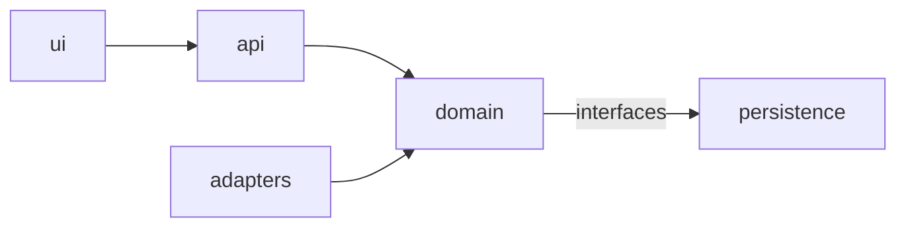

# Architecture Map

<!-- Agentic Delivery Standard v1.0 · tier: SEED (project-owned). CUSTOMIZE every [bracket]. Agents read this to decide WHERE
     code goes. Keep it a map: what exists, who owns what, what may depend on what. Update it in the same PR as structural changes. -->

## 1. Context
- **System**: [name] — [one-paragraph purpose and users]
- **Upstream systems** (we consume): [e.g. rights, programme metadata, promos/commercials systems — protocol, owner]
- **Downstream systems** (we feed): [e.g. integration middleware, MAM — protocol, owner]
- **Runtime**: [language/version, framework, hosting, data stores, messaging]

## 2. Module map
| Module / folder | Concern (one) | Notes |
|---|---|---|
| `[src/domain/<domain>/]` | Domain rules for [domain] | Pure: no framework, I/O or UI imports |
| `[src/adapters/<system>/]` | Integration with [system] | Mapping + transport only; no business rules |
| `[src/api/]` | Routing / transport | Validates input, calls domain, maps output |
| `[src/ui/]` | Presentation | Displays values; computes nothing |
| `[src/persistence/]` | Storage | Repositories; schema migrations in `[migrations/]` |

## 3. Domain ownership (engineering invariant INV-1)
| Domain | Owning module | Rules document | Owner (team/person) |
|---|---|---|---|
| [e.g. Ingest request rules] | `[src/domain/ingest/]` | `[docs/rules/INGEST_RULES.md]` | [name] |
| [e.g. Audio/subtitle component rules] | `[src/domain/components/]` | `[docs/rules/COMPONENT_RULES.md]` | [name] |

A rule belongs to exactly one domain. If you cannot find the owner, stop and ask — do not create a second home.

## 4. Dependency rules (enforced by the `architecture-rules` check)
- `ui` → `api` → `domain` ← `adapters`; `persistence` is used by `domain` only through interfaces defined in `domain`.
- `domain` must not import `ui`, `api`, frameworks, HTTP clients or ORM sessions.
- Modules talk to another domain only through its public interface (`[index/__init__/public API]`).
- [Project-specific rules]

## 5. Contracts and data
- APIs: `[contracts/ or openapi.yaml]` · Messages/events: `[schemas/]` · Files: `[formats/]`
- Data stores and key entities: [list] · Data classification: [public / internal / confidential / personal]

## 6. Cross-cutting
- Logging: [library, structured fields, correlation ID] · Errors: [pattern] · Config: [mechanism] · Feature flags: [mechanism]
- Security: [authn/authz approach, secrets manager]

## 7. Where does new code go? (quick decision guide)
1. A business rule → the owning domain module (section 3). New domain? Write an ADR first.
2. Talking to another system → an adapter; mapping only, rules stay in the domain.
3. A new endpoint/screen → api/ui calls the domain; no calculations there.
4. Shared helpers → only after a second real use (INV-2), in the owner or `[src/shared/]`.

## 8. Diagram (optional)

