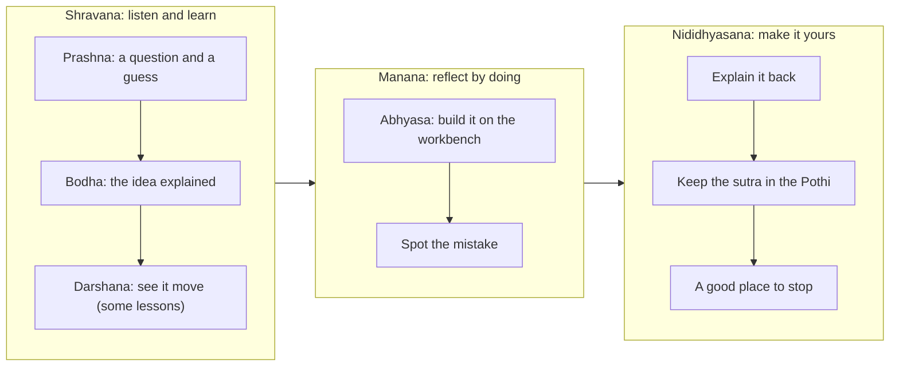

# Gurukul: product concept

> Product name: **Gurukul** (decided 2026-10-11; see [ADR-0002](../decisions/0002-gurukul-frame-and-subjects.md)) · Learn GPT 2.0 · For children about 10 years old (Class 5) · Phase 1: mathematics · Phase 2: mathematics, science and social studies · Status: draft for product review
>
> Companion documents: [RESEARCH.md](RESEARCH.md) (evidence) · [EXPERIENCE.md](EXPERIENCE.md) (screens, motion, visual system) · [CURRICULUM.md](CURRICULUM.md) (phase 1 maths) · [CURRICULUM_PHASE2.md](CURRICULUM_PHASE2.md) (every Class 5 chapter in three subjects) · [SPECKIT_HANDOFF.md](SPECKIT_HANDOFF.md) (how to build it) · prototype: [`design/prototype/index.html`](../../design/prototype/index.html)

---

## 1. One line

**A quiet place to understand: learn the idea, hold it in your hands, make it yours.**

Gurukul is a free, calm, phone-first learning companion for 10-year-olds. Every concept is first **explained clearly in words and pictures**, then becomes a **living model** the child holds, stretches, cuts and turns, and finally becomes **a sentence in the child's own words**. No points, no mascot, no noise: only the idea, in the child's own language.

## 2. The problem

Children today can get any answer from a machine in a second. What they can't get from a machine is **understanding**: a felt sense of *why* 23 × 14 = 322, *why* a shadow is short at noon, *why* we count backwards before year 1.

Most learning apps for children fall into one of three traps:

1. **Game skins**: points, streaks and cartoon rewards wrapped around drill. Children chase the reward and not the idea, and parents see a game.
2. **Pictures of explanations**: a diagram, an animation or a paragraph. The child watches; nothing they do changes anything.
3. **Doing without knowing**: activities with no clear statement of what is being learned. The child plays, but cannot say what the idea was. Phase 1 product review found our own prototype leaning this way: children were asked to try before being told what they were learning.

Learn GPT v1 fell into the first two. [RESEARCH.md §1](RESEARCH.md#1-why-the-first-app-failed) has the failure analysis; §11 covers the evidence for explaining before practising.

## 3. Who it is for

| | |
|---|---|
| **Primary: the child, about 9–11 (Class 5)** | Can reason about things they can see; struggles when symbols arrive with nothing behind them. Uses a parent's phone for 10–20 minutes at a time. May think best in Telugu, Hindi, Bengali or Tamil, while school uses English terms. |
| **Secondary: the parent** | Wants something that genuinely helps with school, is not a game, is safe and free, and doesn't need setting up. Decides in about 30 seconds whether to hand over the phone. |
| **Tertiary: the teacher** (later phase) | May project a model in class. Not designed for yet, but nothing should prevent it. |

Personas used in design reviews:

- **Meera, 10, Vijayawada.** Uses her mother's phone after school. Thinks in Telugu, learns terms in English at school. Quick with mental sums; lost on fractions, maps and "why is it hot in summer?".
- **Arjun, 10, Kolkata.** English-medium school; grandmother helps with homework in Bengali. Loves drawing and history stories; dislikes timed tests.
- **Sunita, Meera's mother.** Uninstalled two "learning games" that kept sending notifications. Will keep an app that she can see is teaching what school teaches.

## 4. The big idea: a modern gurukul

A **gurukul** was a place of learning where a child lived and studied close to a teacher, often outdoors, learning by listening, questioning, doing and reflecting. Gurukul keeps the parts of that idea that still matter and leaves the rest:

| We keep | We leave |
|---|---|
| One child, one patient teacher's voice, at the child's pace | Exclusion: historically many children were kept out. Here **every child belongs**: any gender, caste, faith, language or ability |
| Understanding before marks; asking "why?" is welcome | Religious ritual or iconography: the frame is cultural and **secular** |
| Learning in a calm, open place under a tree | Strict hierarchy: the teacher is a guide, never a judge |
| Learning in three movements: listen, reflect, make it your own | Rote memorisation without meaning |

The modern precedent is **Rabindranath Tagore's open-air school at Santiniketan** (1901), which drew on the gurukul ideal of learning in nature with a close teacher while welcoming modern science. We also draw on the reasoning traditions of **Nalanda** and the **thinnai** verandah schools of Tamil Nadu. [RESEARCH.md §12](RESEARCH.md#12-cultural-grounding-for-the-gurukul-frame) has the sources and the guardrails.

### 4.1 Sutra: the thread and the rule

**Sutra** means both a *thread* and *a short rule that holds a big idea* (as in the Sulba Sutras of rope geometry). In Gurukul:

- A **sutra** (thread) is a strand of one subject, such as *Sankhya* (numbers) in mathematics or *Prakasha* (light) in science.
- Each **knot** on a thread is one concept: one lesson of about 10–15 minutes.
- Every lesson ends with a **sutra** (rule): one memorable sentence the child keeps in their **Pothi** (palm-leaf book), plus the sentence they build in their own words.
- A single glowing **thread** still draws every model: the edge of a shape, a map's path, a timeline, a ray of light. It is the app's visual signature.

### 4.2 The three movements of every lesson

Classical Indian education describes learning in three movements: *shravana* (listening), *manana* (reflecting) and *nididhyasana* (making it part of you). Every Gurukul lesson follows them, and a quiet stage bar at the top of the screen shows where the child is:

### 4.3 Bodha: explain the concept before the child tries

Product feedback on phase 1 was clear: children were sent straight to "try it" without being told what they were learning. **Bodha** (understanding) is the answer. It is a short, learner-paced explanation of five or six cards, each with at most three short sentences and a live diagram:

1. **What we are learning**: the idea in one plain sentence, and what you will be able to do.
2. **The idea**: the concept explained, with key words you can tap.
3. **Why it works**: the reason behind it, not just the rule.
4. **A worked example**: revealed one step at a time.
5. **Where you see it**: the idea in Indian daily life.
6. **The sutra**: the one-line rule to keep.

Text is welcome here: Bodha is reading and listening, with narration and captions for every card. The workbench then lets the child test what they just learned with their hands. A **"What am I learning?"** button on every workbench reopens Bodha at any time.

## 5. The Ashram and its Shalas

The home screen is the **Ashram**: a calm courtyard around a banyan tree. Each subject is a **Shala** (hall) off the courtyard:

| Shala | Subject | Threads (sutras) |
|---|---|---|
| **Ganita** · गणित · గణితం · গণিত · கணிதம் | Mathematics | Sankhya (numbers), Ganana (operations), Guna (factors and multiples), Rekha (shapes and space), Mana (measurement), Ankana (data), Krama (patterns), Tarka (sets and logic) |
| **Vijnana** · विज्ञान · విజ్ఞానం · বিজ্ঞান · அறிவியல் | Science | Sharira (our body), Jiva (living things), Padartha (materials), Bala (forces), Prakasha (light), Mapana (measuring) |
| **Loka** · लोक · లోకం · লোক · உலகம் | Social studies | Itihasa (history and time), Bhugola (the Earth and maps), Bharata (our country), Nagarika (citizens and our world) |

Section names are shown in the child's language and script, with the plain school subject underneath (for example "Ganita · Mathematics"). Ganita is the everyday school word for mathematics in all five languages (Tamil கணிதம்), and Vijnana is the school word for science in four of them. Tamil uses its own word, அறிவியல், and the app follows the child's language rather than forcing Sanskrit. *Loka* means "the world and its people"; Tamil uses உலகம். All names are drafts for teacher review. [CURRICULUM_PHASE2.md](CURRICULUM_PHASE2.md) maps every Class 5 chapter to a thread and a knot.

Around the courtyard:

- **Jaal** (the web): a map of the threads that cross between subjects. A shadow is also a clock for the turning Earth; a map's scale is measurement; a timeline is a number line for years.
- **Pothi**: the child's palm-leaf book of sentences, sutras and model pictures.
- **Acharya corner**: the page for parents and teachers, behind a grown-up check.

## 6. Principles

1. **Explain, then hold, then own.** Every lesson tells the child clearly what they are learning (Bodha), then lets them build it (Abhyasa), then asks them to say it (Explain it back).
2. **Hold, then name.** Every symbol grows out of an object the child is manipulating. The equation, label or date is the *shadow* of the model, updated live.
3. **One idea, many faces.** Every concept appears in at least three linked representations: words, a picture, and a model (plus symbols where they belong).
4. **A moment of wonder first.** A short question and a committed guess before Bodha make the explanation answer something the child already wonders about ([RESEARCH C5, C6](RESEARCH.md#3-instruction-order-teach-first-but-let-them-predict)).
5. **The model tells the truth.** Correctness is visible: the share comes out even, the car stops sooner on sand, the shadow shortens. No "Great job!", no stars, no chimes.
6. **Mistakes are material.** Every lesson includes a believable wrong idea to diagnose, drawn from what children really think (in science, from misconception research). Wrong moves get a gentle, specific hint about the idea, never a red cross.
7. **Your language, and a bridge.** Five languages, switchable instantly mid-lesson. Key words are tappable and show the everyday meaning, the school word and the English term.
8. **Respect the child's time.** Sessions of 10–15 minutes ending at a natural stopping point. No feeds, no notifications, no streaks.
9. **Private by construction.** No accounts, no analytics, no ads, no network calls needed to learn. Everything lives on the device.
10. **Beauty is not decoration.** The wow comes from the idea itself: a hundred thousand rolling into one lakh, the Earth turning India into night, light drawing a shadow.

## 7. Signature moments

Each is designed to make an adult stop and say "oh". Each is also a complete lesson, not a trick.

| Moment | Shala | What the child does | What they understand |
|---|---|---|---|
| **The opening thread** | — | Watches one line of light weave a kolam, then grow into the banyan of the Ashram | "This is a calm place of patterns" |
| **Rubber Rectangle** | Ganita | Stretches a rectangle to 23 × 14, cuts it at the tens, folds the rooms into the column method | Why long multiplication works |
| **The lakh roll-over** | Ganita | Adds one bead to 99,999 and watches every column bundle into the next, ending at 1,00,000 | Each place is ten of the one beside it; how lakh and crore commas work |
| **Folding strips** | Ganita | Folds a paper strip into halves, quarters and eighths and lines them up | 1/2 = 2/4 = 4/8: different names, same amount |
| **The rupee grid** | Ganita | Shades a rupee made of 100 paise squares to build ₹0.5 and ₹0.45 | Why ₹0.5 is more than ₹0.45; tenths and hundredths |
| **Journey of a roti** | Vijnana | Scrubs one bite of roti through the body; it breaks into pieces small enough for the blood | Digestion, and where food really enters the blood |
| **The ramp test** | Vijnana | Rolls a toy car onto tile, wood, cloth and sand, changing only one thing at a time | Friction, and how a fair test works |
| **The lamp and the stick** | Vijnana | Moves a lamp across the sky and watches the shadow stretch and shrink | Light travels in straight lines; why noon shadows are short |
| **Thread of time** | Loka | Hangs events from Mohenjo-daro to Chandrayaan-3 on one thread, across BCE and CE | Timelines, centuries, and why there is no year zero |
| **Spin and travel** | Loka | Turns the Earth to put India in night, then carries it round the Sun to winter | Day and night from spinning; seasons from the tilt, not distance |
| **Courtyard from above** | Loka | Walks a path across a map of the Ashram with north, east, south and west, then reads the scale | Maps: direction, symbols and scale |
| **Sorting Courtyard and Marble Machine** | Ganita | Sorts blocks into rope rings; drops marbles through AND, OR and NOT gates | Sets and logic as visible cause and effect |

## 8. The shape of a session

One **knot** is one concept, about 10–15 minutes:

1. **Prashna** (under a minute). A striking question; the child commits to a guess. *"Is a lakh more or less than a million?"*
2. **Bodha** (2–4 minutes). Five or six cards: the idea explained in words and pictures, read aloud, at the child's pace.
3. **Darshana** (some lessons, 2–3 minutes). A Living Film: a narrated, scrubbable scene the child can pause and hold.
4. **Abhyasa** (4–6 minutes). The workbench, with steps that fade from fully worked to independent.
5. **Spot the mistake**. A believable wrong idea to find.
6. **Explain it back**. The child builds a sentence, or records one, to keep.
7. **Pothi**. Their model picture, their sentence and the sutra are kept as a page.
8. **A good place to stop**. A calm close that names what they now know.
9. **Return** (next session). The Ashram asks "Remember this?" about an earlier sutra before anything new.

## 9. What we will not do

- No points, coins, XP, stars, badges, streaks, lives, levels to unlock, or leaderboards.
- No mascot or cartoon character, and no guru avatar. The teacher is a voice; a demonstrating *hand* is the only figure.
- No religious symbols, rituals or prayers; no portrayal of any group as the "real" heirs of the gurukul.
- No confetti, success chimes or "Awesome!" pop-ups.
- No timers or speed rounds.
- No push notifications.
- No chatbot, and no AI-generated content shown to children.
- No accounts, logins, analytics, ads or third-party trackers.
- No video files: every explanation is text, a live diagram, or a live, grabbable scene.
- No truncated text, and no layouts that only work in English.

## 10. Name

The product is **Gurukul**. "Sutra" is kept as the word for threads and rules inside it; internal prototype code still uses `Sutra` as its namespace, which children never see.

Because "gurukul" is a common word used by many schools and apps, a trademark and app-store search is still needed, and a distinguishing subtitle may be required (for example "Gurukul: learn, hold, make it yours"). See [SPECKIT_HANDOFF.md §4](SPECKIT_HANDOFF.md#4-open-decisions-need-a-human).

## 11. What success looks like

Measured in research sessions with consenting families, never through in-app telemetry:

- After Bodha, a child can **say what they are learning** in one sentence before touching the workbench.
- After one lesson, a child can **explain** the concept in their own words, not just answer a question.
- A child can **transfer**: solve a problem in a context they haven't seen (an L-shaped room after Rubber Rectangle; a sundial after the lamp and the stick).
- A child **chooses** to open a second knot without being told to.
- A parent, shown the app for 60 seconds, says some version of "this is what school is teaching, but they actually understand it".
- Every screen works in all five languages without clipped or broken text.
