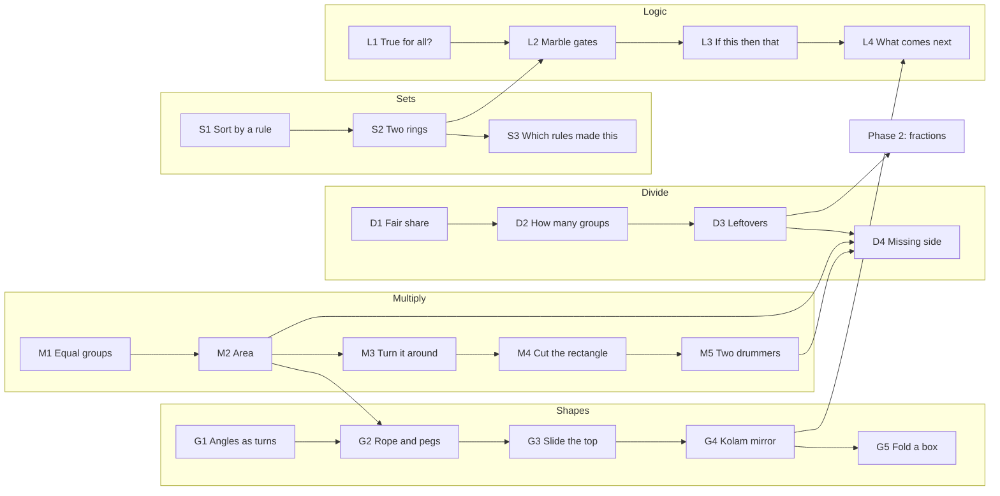

# Sutra: phase 1 curriculum (mathematics, about age 10)

> Status: draft for review by a primary maths teacher (2026-10-11).
> **Translations in this document are drafts and need review by a native-speaking primary maths teacher for each language before use.**
> *Maths Mela* chapter links are based on chapter titles in NCERT's Grade 5 textbook and must be confirmed against the chapter content.

---

## 1. How to read this

- A **domain** is a thread on the Loom (Multiply, Divide, Shapes, Sets, Logic).
- A **thread** (ID like `M2`) is one concept, one session of 10–15 minutes, with the anatomy in [EXPERIENCE.md §3](EXPERIENCE.md#3-lesson-anatomy-in-detail).
- **Lenses** are the linked representations shown together (at least three per thread).
- **Misconception** is the specific wrong idea the thread is designed to surface and fix. Hints and the Spot-the-mistake step are written against it.
- **Proto** marks threads shown in the clickable prototype.

## 2. The concept map

Recommended order inside a domain is left to right. Across domains the child chooses freely; the crossings above are where the Loom explains a connection.

---

## 3. Multiply

### M1 · Equal groups and arrays
- **Goal:** see multiplication as a number of equal groups, and arrange groups into rows (arrays).
- **Misconception:** "multiplying is just adding the two numbers"; groups need not be equal.
- **Wonder:** a coconut seller has 7 bunches with 4 coconuts each. Guess the total before counting.
- **Lenses:** loose groups → an array → skip-counting on a number line (4, 8, 12 …).
- **Film beats:** (1) count one by one, which is slow; (2) put them in equal groups; (3) line the groups up into rows; (4) count by rows; (5) write 7 × 4 and read it "7 groups of 4".
- **Workbench:** make 3 × 5, 5 × 3 and 6 × 2 by dragging coconuts into bunches; the array forms live.
- **Spot the mistake:** "7 bunches of 4 is 11". The model shows 7 bunches and 11 coconuts, which doesn't fill them.
- **Explain back:** "Multiplying means ___ groups of the same size."
- **Maths Mela:** Coconut Farm.

### M2 · Multiplication is area · **Proto** (Wonder + Living Film)
- **Goal:** understand a × b as the number of unit squares covering an a-by-b rectangle.
- **Misconception:** area is "length + breadth"; area is a formula to remember rather than a count of squares.
- **Wonder:** a courtyard is being tiled with square tiles, 6 along one side and 4 along the other. Guess how many tiles are needed.
- **Lenses:** tiles on the floor → rows of the array → jumps on a number line.
- **Film beats:** (1) one tile is one unit square; (2) one row fills: 6 tiles; (3) rows stack: 6, 12, 18, 24; (4) the rectangle's sides become the factors (indigo 6, teal 4); (5) area = 6 × 4 = 24 square units, and a ghost of the first row remains.
- **Workbench:** stretch the courtyard to match a target number of tiles (e.g. "make a floor with 18 tiles"); find two different floors with 12.
- **Spot the mistake:** "6 by 4 needs 10 tiles". The model shows 10 tiles covering less than half.
- **Explain back:** "The number of tiles is ___ rows of ___."
- **Maths Mela:** Grandmother's Quilt.

### M3 · Turn it around
- **Goal:** a × b = b × a, because turning a rectangle doesn't change how many squares it has.
- **Misconception:** 3 × 8 and 8 × 3 are unrelated facts to learn separately.
- **Wonder:** is 3 rows of 8 the same amount as 8 rows of 3? Guess yes or no.
- **Lenses:** the rectangle rotating 90° → equal groups regrouped → the multiplication table's mirror diagonal.
- **Film beats:** (1) build 3 × 8; (2) rotate it with the thread; (3) it becomes 8 × 3 and nothing was added or removed; (4) the times table lights up as a mirror.
- **Workbench:** rotate any rectangle; find all "mirror pairs" on the table up to 10 × 10.
- **Spot the mistake:** "8 × 3 = 24, so 3 × 8 must be 38".
- **Explain back:** "Turning the rectangle doesn't change ___."

### M4 · Cut the rectangle · **Proto** (Rubber Rectangle)
- **Goal:** split factors into tens and ones to multiply two-digit numbers (distributive property), and see why the column method works.
- **Misconception:** 23 × 14 = (20 × 10) + (3 × 4) = 212, forgetting the cross pieces.
- **Wonder:** a 23-by-14 floor. Guess: more than 300 tiles, or fewer?
- **Lenses:** the area model cut into four pieces → partial products → the written column method.
- **Film beats:** (1) build 23 × 14, far too many tiles to count; (2) cut 23 into 20 + 3 with the thread; (3) cut 14 into 10 + 4; (4) four rooms: 200, 80, 30, 12; (5) the rooms slide into the column method rows and add up to 322.
- **Workbench:** drag the corner to any size up to 30 × 30; tap "cut at the tens" and read the four parts; then do 2-digit × 1-digit with one cut.
- **Spot the mistake:** "23 × 14 = 200 + 12 = 212". Two rooms are visibly empty.
- **Explain back:** "I cut the rectangle into ___ parts and added them because ___."

### M5 · Two drummers · **Proto**
- **Goal:** multiples, and common multiples (the least common multiple) as two cycles meeting.
- **Misconception:** the common multiple of two numbers is always their product.
- **Wonder:** one drummer hits every 3rd beat, the other every 4th. On which beat do they first hit together?
- **Lenses:** two rhythm rings → marks on a shared number line → lists of multiples.
- **Film beats:** (1) one drummer, a beat every 3: 3, 6, 9 …; (2) a second every 4; (3) they meet at 12; (4) try 4 and 6: they meet at 12, not 24; (5) why: the meeting point is the first number in both lists.
- **Workbench:** set any two cycles from 2 to 9; predict the meeting beat; play to check.
- **Spot the mistake:** "4 and 6 first meet at 24".
- **Explain back:** "They meet at the first number that is in ___ lists."
- **Maths Mela:** Animal Jumps.

---

## 4. Divide

### D1 · Fair share · **Proto** (Fair Share Table)
- **Goal:** division as sharing equally (partitive): total ÷ number of groups = size of each group.
- **Misconception:** sharing can be unequal; division always "comes out".
- **Wonder:** 12 laddoos for 4 friends. How many does each friend get?
- **Lenses:** dealing onto plates → a bar split into equal parts → the multiplication fact read backwards (4 × 3 = 12).
- **Film beats:** (1) deal one to each plate, round and round; (2) every plate has the same; (3) write 12 ÷ 4 = 3; (4) see it as 4 groups of 3, which is the rectangle again.
- **Workbench:** change the number of laddoos and plates; deal one at a time or all at once.
- **Spot the mistake:** "12 ÷ 4 = 8", where someone took away 4.
- **Explain back:** "Sharing fairly means every plate gets ___."
- **Maths Mela:** The Dairy Farm.

### D2 · How many groups?
- **Goal:** division as grouping (quotative): how many groups of a given size fit in the total.
- **Misconception:** only "sharing" is division; the two kinds give different answers.
- **Wonder:** 23 children going to school by auto, 4 per auto. How many autos are needed?
- **Lenses:** filling autos → jumps backwards on a number line → repeated subtraction.
- **Film beats:** (1) fill one auto with 4; (2) another and another; (3) 5 autos full, 3 children left; (4) a 6th auto is needed, so the context decides what the remainder means.
- **Workbench:** set the total and group size; fill groups; the number line jumps back with each group.
- **Spot the mistake:** "23 ÷ 4 = 5, so 5 autos". Three children are left on the road.
- **Explain back:** "This time I asked how many ___ fit in ___."

### D3 · Leftovers · **Proto** (Fair Share Table, remainder tray)
- **Goal:** remainders, and cutting leftovers into equal parts as the doorway to fractions.
- **Misconception:** the remainder is "thrown away"; remainders can be bigger than the divisor.
- **Wonder:** 14 laddoos for 4 friends. What happens to the ones that don't fit?
- **Lenses:** remainder tray → leftover pieces cut into quarters → 14 ÷ 4 = 3 r 2 = 3½.
- **Film beats:** (1) deal until you can't; (2) 2 left; (3) cut each leftover into 4 pieces; (4) each friend gets 3 and 2 quarters, which is 3 and a half.
- **Workbench:** try totals 10–30 over 2–6 plates; cut the leftovers.
- **Spot the mistake:** "14 ÷ 4 = 3 remainder 6".
- **Explain back:** "The leftover is always smaller than ___ because ___."
- **Maths Mela:** Fractions.

### D4 · Missing side
- **Goal:** division as the inverse of multiplication: a rectangle with a known area and one known side; find the other side. Factors as all the rectangles of a number.
- **Misconception:** division is a separate operation with its own facts to memorise.
- **Wonder:** a floor has 24 tiles and is 6 tiles long. How wide is it?
- **Lenses:** a rectangle with a hidden side → a fact family (6 × 4, 4 × 6, 24 ÷ 6, 24 ÷ 4) → all the rectangles of 24 (factor pairs).
- **Film beats:** (1) the 24-tile floor with one side covered; (2) slide the cover away row by row; (3) 4 rows; (4) find every rectangle that uses exactly 24 tiles.
- **Workbench:** "find every floor of 36" (factor pairs); a prime number has only one floor.
- **Spot the mistake:** "24 has rectangles 3 × 8, 4 × 6, and 5 × 5".
- **Explain back:** "Dividing finds the ___ side when I know the ___."

---

## 5. Shapes

### G1 · Angles as turns
- **Goal:** an angle is an amount of turn; a full turn, a half turn, a quarter turn; comparing angles.
- **Misconception:** longer arms make a bigger angle.
- **Wonder:** two clock hands, one long and one short, open the same way. Which angle is bigger?
- **Lenses:** a turning arm → a fraction of a full circle → degrees (90°, 180°, 360°).
- **Film beats:** (1) a door opening; (2) the turn traced as an arc; (3) stretch the arms: the arc stays the same; (4) quarter turns build up to a full turn.
- **Workbench:** turn an arm to match targets; compare two angles with different arm lengths.
- **Maths Mela:** Angles as Turns.

### G2 · Rope and pegs · **Proto**
- **Goal:** perimeter and area are different; the same perimeter can enclose different areas; the square encloses the most.
- **Misconception:** shapes with the same perimeter have the same area.
- **Wonder:** a 24-metre rope fences a vegetable patch. Does the shape change how much ground it holds?
- **Lenses:** the rope rectangle → a table of sides and areas → a growing "area curve" of tried rectangles.
- **Film beats:** (1) a rope of 24 on four pegs; (2) a thin 11 × 1 patch: area 11; (3) pull it fatter: 8 × 4 = 32; (4) 6 × 6 = 36, the most; (5) the ghosts of every try line up into a hill.
- **Workbench:** drag a corner; the rope keeps its length; record areas; find the biggest; then a 20-metre rope.
- **Spot the mistake:** "same rope, so same area".
- **Explain back:** "The rope stays ___ but the area ___."
- **Sulba Sutras** context: rope-and-peg geometry.

### G3 · Slide the top
- **Goal:** a parallelogram has the same area as the rectangle with the same base and height (conservation of area under shear).
- **Misconception:** a slanted shape is "bigger" because its sides got longer.
- **Wonder:** slide the top of a rectangle sideways. Does it hold more, less, or the same?
- **Lenses:** shearing with ghost rectangle → cutting off a triangle and moving it → base × height.
- **Film beats:** (1) a rectangle; (2) drag the top along its guide rail; (3) slice off the overhanging triangle; (4) it fits the gap exactly.
- **Workbench:** shear freely; the area readout stays fixed while the perimeter changes.

### G4 · Kolam mirror · **Proto**
- **Goal:** line (mirror) symmetry versus rotational symmetry; order of rotational symmetry.
- **Misconception:** every symmetrical pattern has a mirror line; rotation and reflection are the same thing.
- **Wonder:** a kolam at a doorstep. Fold it in your mind: do the halves match? Turn it: does it look the same?
- **Lenses:** drawing with live symmetry → mirror lines and turn centre shown → "order 4" written.
- **Film beats:** (1) one stroke; (2) its mirror image appears; (3) four-fold; (4) switch to rotation-only: still beautiful, but no mirror line.
- **Workbench:** draw with 1, 2, 4 or 8-fold, mirror or rotation; challenge: "make a pattern that looks the same after a quarter turn but has no mirror line".
- **Maths Mela:** Symmetrical Designs; Shapes and Patterns.

### G5 · Fold a box
- **Goal:** nets of a cube; which flat patterns fold into a cube.
- **Misconception:** any six joined squares fold into a cube.
- **Wonder:** which of these flat shapes folds into a box?
- **Lenses:** flat net → folding animation (scrubbable) → the faces labelled to match.
- **Workbench:** arrange six squares; fold to test; find several working nets.

---

## 6. Sets

### S1 · Sort by a rule
- **Goal:** a set is a collection defined by a rule; "in" and "out" of a set.
- **Misconception:** sorting is by appearance only; an object can't fit two rules.
- **Wonder:** a basket of fruits and vegetables. Find a rule that splits them into two groups.
- **Lenses:** one rope ring on the floor → a list → set notation `{ }`.
- **Workbench:** choose a rule chip; drop the ring; objects walk in or stay out.

### S2 · Two rings · **Proto** (Sorting Courtyard)
- **Goal:** Venn diagrams with two sets: overlap ("and"), union ("or"), outside ("not").
- **Misconception:** an object belonging to both sets must be put in one of them.
- **Wonder:** two rings, "red" and "round". Where does a red ball go?
- **Lenses:** objects walking into regions → region counts → words "and", "or", "not" mapped to regions.
- **Film beats:** (1) the "red" ring; (2) the "round" ring; (3) push them together: the red round things walk into the overlap; (4) name the regions.
- **Workbench:** change rules; drag rings apart (disjoint) or one inside the other (subset).
- **Maths Mela:** Data Through Pictures (sorting and representing).

### S3 · Which rules made this?
- **Goal:** reason backwards from a finished sort to the rules.
- **Misconception:** there is only one possible rule for any group.
- **Wonder:** these objects were sorted by two hidden rules. Can you name them?
- **Workbench:** inspect objects in each region; propose rules; the rings re-sort to test.

---

## 7. Logic

### L1 · True for all?
- **Goal:** statements can be true or false; one counterexample disproves "all".
- **Misconception:** many examples prove a statement.
- **Wonder:** "Every number that ends in 4 can be shared equally between 4 friends." True?
- **Lenses:** testing examples on the Fair Share Table → a found counterexample (14) → "not always".

### L2 · Marble gates · **Proto** (Marble Machine)
- **Goal:** AND, OR and NOT as physical gates; truth tables.
- **Misconception:** "or" means "only one"; "and" and "or" give the same results.
- **Wonder:** a marble passes a gate only if switch A *and* switch B are open. How many ways can it get through?
- **Lenses:** the marble machine → a truth table written one row per try → words (and, or, not) and the matching Venn region from S2.
- **Film beats:** (1) one switch; (2) two switches in a row (AND); (3) two side-by-side paths (OR); (4) NOT flips the path.
- **Workbench:** set switches, choose a gate, drop a marble; fill the truth table; find the gate that gives a mystery table.

### L3 · If this, then that
- **Goal:** conditional statements; the difference between "if A then B" and "if B then A".
- **Misconception:** "if it rains, the ground is wet" means "if the ground is wet, it rained".
- **Lenses:** marble machine paths → a two-ring picture (A inside B) → sentences.

### L4 · What comes next?
- **Goal:** finding and explaining the rule of a growing pattern.
- **Misconception:** a pattern is "what it looks like" rather than the rule that makes it.
- **Wonder:** a kolam grows from 1 dot to 4 to 9. How many dots in the next one?
- **Lenses:** growing kolam → table → the rule in words (n × n).

---

## 8. Key terms in three registers (draft translations)

Each key term appears with (1) an everyday phrase, (2) the regional maths term, (3) the English term and symbol. The table below gives the regional terms. **All entries need native-speaker teacher review.**

| English | Symbol | Hindi | Telugu | Bengali | Tamil |
|---|---|---|---|---|---|
| Multiplication | × | गुणा | గుణకారం | গুণ | பெருக்கல் |
| Division | ÷ | भाग | భాగహారం | ভাগ | வகுத்தல் |
| Area | l × b | क्षेत्रफल | వైశాల్యం | ক্ষেত্রফল | பரப்பளவு |
| Perimeter | P | परिमाप | చుట్టుకొలత | পরিসীমা | சுற்றளவு |
| Rectangle | ▭ | आयत | దీర్ఘచతురస్రం | আয়তক্ষেত্র | செவ்வகம் |
| Angle | ∠ | कोण | కోణం | কোণ | கோணம் |
| Symmetry | | सममिति | సౌష్ఠవం | প্রতিসাম্য | சமச்சீர் |
| Remainder | r | शेषफल | శేషం | ভাগশেষ | மீதி |
| Fraction | ½ | भिन्न | భిన్నం | ভগ্নাংশ | பின்னம் |
| Factor | | गुणनखंड | కారణాంకం | উৎপাদক | காரணி |
| Multiple | | गुणज | గుణిజం | গুণিতক | மடங்கு |
| Set | { } | समुच्चय | సమితి | সেট | கணம் |
| And / Or / Not | ∧ ∨ ¬ | और / या / नहीं | మరియు / లేదా / కాదు | এবং / অথবা / না | மற்றும் / அல்லது / இல்லை |
| True / False | | सही / गलत | నిజం / అబద్ధం | সত্য / মিথ্যা | சரி / தவறு |

Everyday-phrase example for **Area** ("how much space it covers"):

| Hindi | Telugu | Bengali | Tamil |
|---|---|---|---|
| कितनी जगह घेरता है | ఎంత జాగా ఆక్రమిస్తుంది | কতটা জায়গা জুড়ে আছে | எவ்வளவு இடம் பிடிக்கிறது |

---

## 9. Phase 2 candidates (not in scope)

Fractions in depth (from D3), decimals and money, measurement (weight, capacity, time: *Maths Mela* chapters Weight and Capacity, Racing Seconds), maps and coordinates (Maps and Locations), data handling, and Lilavati puzzle collections as cross-domain challenges.
