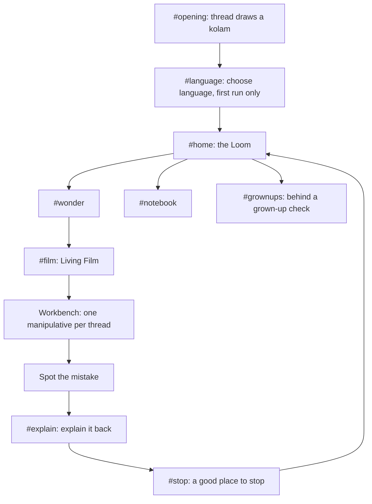

# Sutra: experience design

> Status: draft for product review (2026-10-11) · Phone first (portrait, 360–430 px wide), adapting up to tablet and laptop.
> The clickable prototype at [`design/prototype/index.html`](../../design/prototype/index.html) is the visual reference for this document. Screen IDs below (`#home`, `#film`, …) match the prototype's routes.

---

## 1. Information architecture

There are only **three places**: the **Loom** (where you choose), a **thread** (where you learn), and the **Notebook** (what you made). The Grown-ups page sits outside the child's path. There is no bottom tab bar; children tap bottom-edge controls by accident (RESEARCH C13).

### 1.1 The Loom (home)

The five domains are threads woven across the screen: **Multiply, Divide, Shapes, Sets, Logic**. Each concept is a **knot** on its thread.

- Knots the child has completed are **filled with a tiny thumbnail of the model they built**. Progress is shown by the child's own work, not by stars.
- Threads cross where ideas connect (division crosses multiplication at "missing side"; sets cross logic at "and / or / not"). Tapping a crossing explains the connection in one spoken sentence.
- **Nothing is locked.** A soft "start here" glow marks the suggested next knot on each thread.
- At the top: a **"Continue"** card for the unfinished thread, if there is one. No greeting banner, no name, no streak.

### 1.2 Global chrome

The top bar, about 56 dp, contains only:

- **Back** (left): always visible, always one step back. Never exits the app without confirmation.
- **Title** of the current place, in the current language, wrapping onto two lines if needed (never truncated).
- **Language** (right): a button showing the current script's first letter (`A`, `अ`, `అ`, `অ`, `அ`). One tap opens a sheet with the five languages, each written in its own script. Switching is **instant and in place**; the lesson, the model's state and the film position are kept.
- **Sound** (right): narration on or off.

---

## 2. Screen inventory

| ID | Screen | Purpose | Key elements |
|---|---|---|---|
| `#opening` | Opening thread | Identity in 4 seconds | Five dots; one line weaves a kolam around them, then unravels toward the Loom. Skippable by tap; skipped automatically on later launches |
| `#language` | Choose language | First run only | Five large cards, each language in its own script with a spoken sample on tap. No account, no name, no age gate |
| `#home` | The Loom | Choose what to learn | Five domain threads, knots, Continue card, Notebook entry, Grown-ups link (small, top corner) |
| `#wonder` | Wonder | Activate curiosity and commit to a prediction | One photo-real or illustrated scene, one question, a prediction control (slider or choice), then "Let's find out" |
| `#film` | Living Film | Direct, beautiful explanation | Scene canvas, beat dots (4–6), a scrubber, play/pause, "hold the scene" affordance, optional captions |
| `#rect` | Rubber Rectangle | Multiplication as area; distributive law | Draggable corner handle, unit tiles, "cut with the thread" tool, linked equation and column method |
| `#share` | Fair Share Table | Partitive division and remainders | Pile of laddoos, plates (add or remove), deal one-by-one or all at once, remainder tray, "cut the leftovers" |
| `#rope` | Rope and Pegs | Perimeter versus area | A rope of fixed length on four pegs; drag one corner; live readout of sides, perimeter and area; ghost history of tried rectangles |
| `#kolam` | Kolam Mirror | Reflection versus rotation symmetry | Dot grid; finger drawing; symmetry order (1, 2, 4, 8); mirror or rotate toggle; clear and undo |
| `#drums` | Two Drummers | Common multiples (LCM) | Two rhythm rings with adjustable beat counts; play; meeting beats marked on a shared line |
| `#sets` | Sorting Courtyard | Venn diagrams, and/or/not | Objects with properties; two rope rings with rule chips; objects walk to regions; region counts; "Which rules made this?" mode |
| `#logic` | Marble Machine | AND / OR / NOT as cause and effect | Two input switches (A, B), a gate slot, marble drop, output basins, a truth table that fills one row per try |
| `#mistake` | Spot the mistake | Diagnose a believable error | A worked solution with one wrong step; tap the step; the model shows why |
| `#explain` | Explain it back | Self-explanation | Sentence builder with word tiles in the current language, plus an optional voice recording kept on device |
| `#stop` | A good place to stop | Calm closure | What you now know (one line), your sutra, a thumbnail of your model, "Back to the Loom" |
| `#notebook` | Notebook | The child's own work | Pages: model thumbnail, their sentence, date; tap to reopen the model exactly as they left it |
| `#grownups` | Grown-ups | Reassure and inform the parent | What was learned (plain language), the Notebook, how it works, privacy statement, language, reset. Behind a simple grown-up check |

---

## 3. Lesson anatomy in detail

| Step | Length | Design rules | Evidence |
|---|---|---|---|
| **Wonder** | under 1 min | One question. One image. A prediction the child must commit to. Never graded: the guess is simply remembered and revealed later ("You guessed 20. Let's see."). Names the key objects (pre-training) | RESEARCH C6, C9 (pre-training) |
| **Living Film** | 3–4 min | 4–6 beats of 20–40 s. Narration bound to beats. Tap to continue between beats. Scrub both ways. Pause turns the scene interactive. Ghosts persist. Highlight the part being spoken about; dim the rest | C8, C9 |
| **Workbench** | 4–6 min | Step 1 fully worked (the hand demonstrates). Step 2 half done. Step 3 the child alone. A free "play" mode is always available | C7 |
| **Spot the mistake** | 1–2 min | One believable error drawn from the thread's target misconception | C7 |
| **Explain it back** | 1–2 min | Sentence builder: "When I ___, the ___ stays the same because ___". Tiles in the current language. Optional voice note | C7 |
| **A good place to stop** | 15 s | No score. One line naming the idea, the child's sentence, and their model thumbnail | C11, C12 |
| **Return** (next session) | 1 min | Two recall prompts from earlier, different threads; answered on a mini model; skippable | C10 |

### 3.1 Feedback rules

- **Right** is shown by the model working: the share comes out even, the rectangle's area matches, the marble reaches the basin. The narrator may *describe* what happened ("Every plate has 3; nothing is left"), but never praises.
- **Wrong** is shown by the model too: the leftover sits on the table, the marble falls into the other basin. After two attempts, a **specific hint about the idea** appears, written for the misconception the move reveals. Example: if a child enters 23 + 14 in the area task, the hint is "Count one row. How many rows are there?"
- Hints never say "wrong", "try again" or show a red cross. Kumkum red is used only to point attention, never to judge.

---

## 4. Interaction language

| Pattern | Rule |
|---|---|
| **Handles** | Round, 28 dp visible, 56 dp hit area, a soft turmeric ring. They grow slightly while held. One handle per degree of freedom |
| **The thread as a tool** | The glowing line is also the cutting, wrapping and connecting tool. "Cut" mode turns the finger into a thread that snaps to meaningful positions (tens, halves) |
| **Snapping** | Values snap to whole units with a light haptic tick (where supported). Continuous mode is available only where the maths is continuous |
| **Ghosts** | When a model changes, the previous state stays as a 25% ink outline for the rest of the step. "Clear ghosts" is always available |
| **Linked panes** | Object, picture and symbol panes update in the same frame. Tapping a number in the equation highlights its part in the model, and the reverse |
| **Undo** | Every manipulative has undo and reset. No destructive action without undo |
| **Multi-touch** | Ignored except for two-finger pinch on the Loom. Stray touches never break a model |
| **Rotation** | Portrait is the designed layout. Landscape on phones shows the model larger with panes alongside |

---

## 5. Motion language

Motion exists to **explain change**, never to decorate.

| Motion | Spec |
|---|---|
| Ink draws itself | Strokes reveal along their length, 400–900 ms, ease-out. Used when a new shape or symbol appears |
| Spring | Dragged objects follow the finger 1:1; on release they settle with a critically damped spring (no bounce, no wobble) |
| Fold and unfold | Pieces move along curved paths at 600–900 ms, so the eye can follow where each piece goes |
| Walk to region | Objects in the Sorting Courtyard move to their region one by one, staggered by 60 ms, so the child can watch each decision |
| Dim and highlight | Non-focus elements fade to 35% over 250 ms during narration of a focus element |
| Screen change | 220 ms cross-fade. No sliding carousels, no zoom-bursts |
| Banned | Confetti, particle bursts, screen shake, bouncing buttons, idle animations, parallax |
| Reduced motion | When `prefers-reduced-motion` is set, ink draws instantly, folds become cross-fades, and walks become instant placement with a brief outline pulse |

Frame budget: 60 fps on a low-cost Android phone (about ₹8,000 class). Manipulatives use SVG for fewer than about 300 elements and Canvas above that.

---

## 6. Visual system

### 6.1 Colour

The canvas is warm handmade paper. **Colour carries mathematical meaning only**: the first factor is always indigo, the second always teal, and so on, across every screen.

| Token | Hex | Use |
|---|---|---|
| `paper` | `#F6F1E7` | Background (day) |
| `paper-raised` | `#FFFBF3` | Cards, sheets |
| `paper-sunk` | `#ECE4D4` | Wells, trays, inactive areas |
| `ink` | `#1F2430` | Text, primary strokes |
| `ink-soft` | `#5B6170` | Secondary text |
| `ghost` | `#1F243040` | Previous states (25% ink) |
| `thread` | `#E0A030` | The thread, handles, focus (turmeric) |
| `indigo` | `#3E4C9A` | First quantity / set A / first factor |
| `teal` | `#0F7C80` | Second quantity / set B / second factor |
| `leaf` | `#4E8A3E` | Third quantity / result region |
| `kumkum` | `#C2412D` | Attention pointer only, never "wrong" |
| `night` | `#171A21` | Background (night mode); paper tokens invert, meaning colours brighten 10% |

All text meets WCAG AA (4.5:1) on `paper` and `night`. Meaning is never carried by colour alone; position, label or pattern always backs it up.

### 6.2 Typography

- **Families:** Noto Sans and Noto Serif, with the matching script family for each language: Devanagari (Hindi), Telugu, Bengali, Tamil. Production self-hosts subsetted fonts; the prototype loads them from Google Fonts for convenience only.
- **Scale (px at 1×):** caption 14 · body 17 · lead 20 · title 24 · display 32. Nothing below 14.
- **Weights:** 400 / 500 / 600. No weights below 400; thin strokes break Indic glyphs on cheap screens.
- **Line height:** 1.45 for Latin; **at least 1.65 for Indic scripts**, set per locale with `:lang()`.
- **Never truncate** learning content. Containers grow; rows wrap; toolbars stack vertically when text expands.
- Numerals: Western Arabic numerals (0–9) in all languages, matching school textbooks. Regional numerals are an open question for teachers to review.

### 6.3 Layout

- Phone: one column. Model on top (55–65% of height), linked panes below, controls in the upper-middle "thumb arc", none touching the bottom 24 dp.
- Tablet and laptop: model on the left, panes on the right (the context PDF's split layout).
- Spacing unit 8 dp; generous margins (20 dp phone, 32 dp tablet).

### 6.4 Imagery

Flat ink and paper illustration, drawn in the same thread line. Real Indian contexts: courtyards, kolam thresholds, laddoos and plates, autos, coconut farms, tala and tabla. No characters with faces. Photographs only in Wonder scenes, where they make a question real.

---

## 7. Language and voice

- **Switcher:** always in the top bar. Five languages, each named in its own script. Instant switch that keeps all state. Narration restarts the current sentence in the new language.
- **Three registers for key terms.** When a key term first appears in a thread, it shows as a small "bridge card" attached to the model:
  1. everyday phrase in the child's language, e.g. Telugu *"ఎంత జాగా"* ("how much space");
  2. regional maths term: *వైశాల్యం*;
  3. English term with symbol: **Area** = length × breadth.
  Long-press any key term to hear it in English as well.
- **Narration:** written for listening, in short sentences. Recorded by human voice artists, one per language, in a warm, unhurried register. The prototype uses the device's speech synthesis as a placeholder.
- **Translation process:** English source, then translation by a native-speaking primary maths teacher, review by a second teacher, then on-device screenshot review of every screen. All prototype translations are **drafts** pending this process.

---

## 8. Sound

- **Default:** narration on; no music.
- **Functional sounds only**, quiet and short: a soft tick when a value snaps, a wooden tock when a marble lands. They can be turned off independently of narration.
- **Two Drummers** is the one place sound *is* the maths: the beats are the content, so it carries a visual equivalent for deaf or muted use.

---

## 9. Accessibility

- Touch targets of at least 48 dp; handles 56 dp.
- Every manipulative has a **step-button alternative** (+1 / −1 per dimension) for children who can't drag precisely, and full keyboard support on laptops.
- Screen-reader labels describe the model state, e.g. "Rectangle, 6 rows of 4, 24 tiles".
- Captions are available for all narration in all languages.
- Reduced motion is honoured (§5).
- Colour is never the only carrier of meaning (§6.1).
- No time pressure anywhere.

---

## 10. Grown-ups page

Reached by a small "Grown-ups" link on the Loom, behind a simple check (for example "Hold the two dots at the same time for 2 seconds"), which stops a 10-year-old briefly without needing a PIN or account.

Contents:

1. **What your child explored this week**, in plain language: "Explored why long multiplication works by cutting a rectangle into four parts". No minutes, no scores, no comparisons.
2. **Their Notebook**: the same pages the child sees, including their own sentences and (if recorded) voice notes.
3. **How Sutra teaches**: a 30-second explanation and the principle "no games, no ads, no tracking".
4. **Privacy**: "Everything stays on this phone. We collect nothing."
5. **Settings**: language, narration voice speed, night mode, reset all data (with confirmation and undo window).

---

## 11. Offline, size and performance

- Works fully offline after first load (installable web app; Android packaging later if needed).
- Initial download under 3 MB without narration; narration downloaded per language on demand, about 2–4 MB per domain.
- Living Films are scene descriptions plus audio, not video files: about 50 KB of scene data per film plus narration.
- Cold start under 2 s on a low-cost Android phone; interaction latency under 16 ms.

---

## 12. Empty, error and edge states

| State | Behaviour |
|---|---|
| First launch | Opening thread, then language choice, then the Loom with "start here" glows |
| No progress yet | Notebook shows one sample page labelled "Your pages will appear here", drawn in ghost ink |
| Narration file missing (offline before download) | Captions turn on automatically; a quiet note says narration will download when online |
| App interrupted mid-thread | On return, the Continue card restores the exact step and model state |
| Phone rotated mid-drag | The drag is cancelled safely; the model keeps its last valid state |
| Storage full | Notebook saving pauses with a plain-language note on the Grown-ups page; learning still works |
