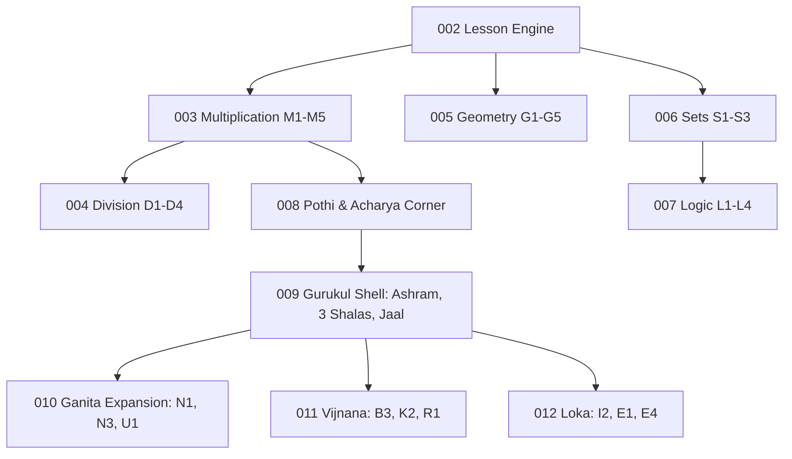

# Gurukul (Learn GPT 2.0): Master Plan & Architectural Design (Features 003–012)

**Document**: `master_plan_003_to_012.md`  
**Status**: Proposal for Unified Design Sign-off  
**Authors**: Antigravity, Puja  
**Target Learner**: 10-year-old child in India (Class 5 CBSE/NCERT/State Boards)  
**Subjects**: Ganita (Mathematics), Vijnana (Science), Loka (Social Studies / World)  
**Languages**: English (`en`), Hindi (`hi`), Telugu (`te`), Bengali (`bn`), Tamil (`ta`)  

---

## 1. Executive Summary & Delivery Philosophy

### 1.1 The Core Mission
Gurukul rejects gamification traps (streaks, points, badges, leaderboard anxiety, and punitive red buzzers). It delivers an interactive, calm, visual learning companion where children explore conceptual manipulatives with reversible physics, discover deep principles through productive failure, and express insights in their own words.

### 1.2 The Phased Execution Sequence
Features 001 (App shell, multi-language typography, dark mode) and 002 (Universal 7-stage lesson engine, Bodha cards, Living Film player) are complete and merged into `main`. The remaining curriculum is phased from Feature 003 to Feature 012:



### 1.3 Architectural Invariants (All Features)
1. **Zero Runtime npm Dependencies**: Plain DOM/SVG, Vite, strict TypeScript.
2. **Domain Decoupling**: Pure business logic lives in `src/domain/{math,science,world,curriculum}/`. Domain functions accept and return plain values/primitives; zero imports of DOM, UI, or framework types.
3. **Calm Feedback Invariant**: Zero praise words ("Good job", "Great", "Bravo") across all 5 languages. Focus highlights use Kumkum (`--kumkum`) strictly for attention ("look here"), never for "wrong".
4. **Accessible Manipulation**: Every draggable canvas handle has an accessible keyboard-operable numeric stepper.
5. **Universal 7-Stage Flow**: Prashna $\to$ Bodha $\to$ Living Film (optional) $\to$ Workbench $\to$ Spot the Mistake $\to$ Explain It Back $\to$ Stop.

---

## 2. Feature-by-Feature Specifications (003 to 012)

---

### Feature 003: Ganita — Multiplication Threads (M1–M5)
- **Subject**: Ganita (Mathematics) · **Threads**: Ganana & Guna
- **Knots**: 
  - `M1`: Equal groups and arrays
  - `M2`: Multiplication is area (courtyard tiling, 6 × 4 = 24, Living Film)
  - `M3`: Turn it around (commutativity $a \times b = b \times a$)
  - `M4`: Cut the rectangle (distributive law, 4 rooms, column method fold)
  - `M5`: Two drummers (tala cycles, least common multiple)
- **Target Misconceptions**:
  - *Cross-term omission*: $23 \times 14 = (20 \times 10) + (3 \times 4) = 212$, omitting $20 \times 4 = 80$ and $3 \times 10 = 30$.
  - *LCM as product*: Assuming common multiples are only the product ($4 \times 6 = 24$, missing 12).
  - *Disjoint facts*: Seeing $3 \times 8$ and $8 \times 3$ as unrelated facts to memorise.
- **Routes**: `#wonder?k=M2`, `#film?k=M2`, `#rect?k=M4`, `#drums`, `#mistake?k=M4`, `#bodha?k=M4`, `#bodha?k=M5`.
- **Domain Module**: `src/domain/math/multiply.ts`
  - `area(w, h)`: Computes unit square area.
  - `splitTensOnes(n)`: Splits 2-digit numbers into tens and ones.
  - `partialProducts(w, h)`: Produces 4-room products ($[ta \times tb, (a-ta) \times tb, ta \times (b-tb), (a-ta) \times (b-tb)]$).
  - `columnMethod(w, h)`: Generates line-by-line values and strip indices.
  - `lcm(a, b)`: Computes least common multiple.
  - `multiples(n, limit)`: Generates multiple lists.
- **Manipulative Components**:
  - `src/ui/manipulatives/area-grid.ts`: Rubber Rectangle with draggable corner, dashed ghost trails, "Cut at tens" thread, and folding highlight strips.
  - `src/ui/manipulatives/drums.ts`: Dual rhythm dials (Indigo & Teal), dual-row beat timeline, pulse animations, audio synthesis tones (`low` for A, `high` for B), and thread ring at LCM.
- **Acceptance Highlights**:
  - `US2-AS1`: $23 \times 14$ cut at tens yields rooms 200, 30, 80, 12 summing to 322.
  - `US2-AS2`: Column folding lights up each calculation row synchronously with its grid strip.
  - `US2-AS3`: Independent step $17 \times 12$ produces rooms 100, 70, 20, 14 (total 204).
  - `US3-AS2`: Faulty step in M4 mistake reveals 4 rooms with 30 & 80 outlined in kumkum.
  - `US4-AS2`: Drummers at 4 and 6 beats ring 12 as first meeting and 24 as next.

---

### Feature 004: Ganita — Division Threads (D1–D4)
- **Subject**: Ganita (Mathematics) · **Thread**: Ganana
- **Knots**:
  - `D1`: Fair share (dealing laddoos round-by-round)
  - `D2`: How many groups (grouping/quotative division)
  - `D3`: Leftovers to fractions (remainders cut into equal fraction parts)
  - `D4`: Missing side (area and one side known; inverse of multiplication)
- **Target Misconceptions**:
  - *Unequal sharing*: Believing division can leave plates unequal.
  - *Discarded remainders*: Treating leftovers as "thrown away" rather than fractional parts.
  - *Division disconnected from multiplication*: Missing that $12 \div 4 = 3$ is verified by $4 \times 3 = 12$.
- **Routes**: `#share?mode=share`, `#share?mode=leftover`, `#bodha?k=D1`, `#bodha?k=D3`.
- **Domain Module**: `src/domain/math/divide.ts`
  - `share(total, plates)`: Computes `{ each, remainder, complete }`.
  - `leftoverFraction(remainder, plates)`: Computes `{ num, den, simpleNum, simpleDen }`.
  - `missingSide(area, side)`: Solves unknown side and factors.
- **Manipulative Components**:
  - `src/ui/manipulatives/fair-share.ts`: Fair Share Table with laddoos, plates, leftover tray, round-by-round dealing animation, and knife tool cutting leftovers into fractions.
  - Linked bar model SVG rendering equal sections and dashed remainder box.
- **Acceptance Highlights**:
  - `US1-AS1`: 12 laddoos on 4 plates deals 3 each, empty tray, showing $12 \div 4 = 3$ and $4 \times 3 = 12$.
  - `US2-AS1`: 14 laddoos on 4 plates yields 3 each and 2 in leftover tray ($14 \div 4 = 3\text{ r }2$).
  - `US2-AS2`: Cutting 2 leftovers across 4 plates gives each plate $2/4 = 1/2$ more ($3\frac{1}{2}$).
  - `US1-AS2`: Any total 2–30 across 2–6 plates guarantees equal plates and remainder < plates.

---

### Feature 005: Ganita — Geometry Threads (G1–G5)
- **Subject**: Ganita (Mathematics) · **Thread**: Rekha
- **Knots**:
  - `G1`: Angles as turns
  - `G2`: Rope and pegs (perimeter vs area, Sulba Sutras geometry)
  - `G3`: Slide the top (shear preserving base and height)
  - `G4`: Kolam mirror (reflectional vs rotational symmetry)
  - `G5`: Fold a box (cube nets)
- **Target Misconceptions**:
  - *Perimeter-area equivalence*: Assuming identical perimeter implies identical area.
  - *Universal mirror symmetry*: Assuming every symmetrical shape has a reflection line.
- **Routes**: `#rope`, `#kolam`, `#bodha?k=G2`, `#bodha?k=G4`.
- **Domain Module**: `src/domain/math/geometry.ts`
  - `perimeterDimensions(perimeter, width)`: Computes `{ w, h, area }`.
  - `smallestTurn(order)`: Computes minimal rotational degree ($360^\circ / \text{order}$).
  - `symmetryAxes(order, mode)`: Computes count of mirror lines vs pure rotation turns.
- **Manipulative Components**:
  - `src/ui/manipulatives/rope.ts`: Peg sliding along diagonal line of constant perimeter ($w + h = P/2$), linked to an "Area Hill" bar histogram showing square peaking.
  - `src/ui/manipulatives/kolam-mirror.ts`: Dark ground canvas with rice-white strokes repeating across orders 1, 2, 4, 8 under mirror or turn-only modes.
- **Acceptance Highlights**:
  - `US1-AS1`: 24m rope sliding peg across all widths keeps perimeter 24m; max area is $36\text{m}^2$ at $6 \times 6$.
  - `US1-AS2`: 20m rope confirms square $5 \times 5 = 25\text{m}^2$ holds the most.
  - `US2-AS1`: Order 4 with turn-only has 0 mirror lines and self-matches after $90^\circ$ turn.
  - `US2-AS2`: Order 4 with mirror confirms 4 mirror lines and $90^\circ$ turns.

---

### Feature 006: Ganita — Set Threads (S1–S3)
- **Subject**: Ganita (Mathematics) · **Thread**: Tarka
- **Knots**:
  - `S1`: Sort by a rule (single property classification)
  - `S2`: Two rings (Venn regions: overlap, union, outside)
  - `S3`: Which rules made this? (reverse sorting induction)
- **Target Misconceptions**:
  - *Exclusive classification*: Believing an object satisfying two rules must belong exclusively to one.
  - *Disjoint confusion*: Inability to identify elements satisfying neither rule.
- **Routes**: `#sets?mode=sort`, `#sets?mode=guess`, `#bodha?k=S2`, `#bodha?k=S3`.
- **Domain Module**: `src/domain/math/sets.ts`
  - `classifyBlock(block, ruleA, ruleB)`: Assigns block to `{ region: 'both' | 'onlyA' | 'onlyB' | 'neither' }`.
  - `regionCounts(blocks, ruleA, ruleB)`: Totals summing to total blocks (12).
  - `evaluateGuess(blocks, targetA, targetB, guessA, guessB)`: Identifies displaced blocks.
- **Manipulative Components**:
  - `src/ui/manipulatives/courtyard.ts`: Courtyard with 12 geometric blocks (colors, shapes, sizes) walking to positions; draggable circular rings; pulling rings apart strands intersection blocks in kumkum.
- **Acceptance Highlights**:
  - `US1-AS1`: Rules yellow & circle partition 12 blocks into both + onlyA + onlyB + neither = 12.
  - `US1-AS2`: Pulling rings apart highlights stranded intersection blocks without a home.
  - `US2-AS1`: In guess mode, selecting the correct hidden rules reveals labels with 0 displaced blocks.

---

### Feature 007: Ganita — Logic Threads (L1–L4)
- **Subject**: Ganita (Mathematics) · **Thread**: Tarka
- **Knots**:
  - `L1`: True for all (counterexamples refuting universal claims)
  - `L2`: Marble machine (physical Boolean logic: AND, OR, NOT)
  - `L3`: If this then that (conditionals and implications)
  - `L4`: What comes next (pattern induction)
- **Target Misconceptions**:
  - *Inclusive vs Exclusive "Or"*: Reading "or" as "only one".
  - *Inductive overconfidence*: Assuming several examples prove a universal rule.
- **Routes**: `#logic`, `#bodha?k=L2`.
- **Domain Module**: `src/domain/math/logic.ts`
  - `gateOutput(gateType, doorA, doorB)`: Evaluates AND, OR, NOT logic.
  - `buildTruthTable(gateType)`: Generates state matrix.
- **Manipulative Components**:
  - `src/ui/manipulatives/marbles.ts`: Marble machine with interactive open/shut gates, rolling marble physics, YES/NO collection buckets, and progressive truth-table accumulator.
- **Acceptance Highlights**:
  - `US1-AS1`: AND gate produces YES only for open/open across all 4 door combinations.
  - `US1-AS2`: OR gate with both doors open lands marble in YES.
  - `US1-AS3`: NOT gate with door A shut routes marble to YES.
  - `US2-AS1`: Mystery machine covered until full truth-table allows naming the gate.

---

### Feature 008: Ganita/Gurukul — Notebook (Pothi), Recall & Acharya Corner
- **Subject**: Universal (Cross-Shala synthesis)
- **Knots**: Metacognitive synthesis across all built knots.
- **Target Misconceptions**:
  - Cramming without retrieval practice; superficial completion without personal explanation.
- **Routes**: `#notebook`, `#grownups`, `#stop`, `#explain`.
- **Domain Module**: `src/domain/curriculum/recall.ts` & `src/persistence/pothi.ts`
  - `generateReturnQuestions(history)`: Spaced interleaved recall generator.
  - `pothiStore`: Local-only persistence for kept sutras, completed sentences, and model snapshots.
- **UI Components**:
  - `src/ui/components/screens/notebook.ts`: The Pothi (sacred learning notebook), newest pages first, model thumbnails, multilingual replay.
  - `src/ui/components/screens/grownups.ts`: Acharya corner protected by 2-finger touch hold; privacy guarantee; narration rate; two-tap "Erase everything".
- **Acceptance Highlights**:
  - `US1-AS2`: Sentence not matching model gives gentle hint; "Keep it as it is" allows saving child's own thought.
  - `US2-AS1`: Page saved in English displays in Bengali upon language switch.
  - `US2-AS2`: Tapping a notebook page re-opens the workbench with saved model state.
  - `US5-AS1`: Single finger cannot open grown-ups portal (requires two-finger hold).
  - `US5-AS2`: Single tap on "Erase everything" does nothing until confirmed by second tap.

---

### Feature 009: Gurukul Shell — Full Multi-Subject Ashram, Shalas & Jaal
- **Subject**: Universal Platform Foundation
- **Core Intent**: Replaces math-only Loom with the complete peaceful Ashram courtyard, three Shalas (Ganita, Vijnana, Loka), and the cross-subject Jaal.
- **Routes**: `#home` (Ashram), `#shala?s=ganita`, `#shala?s=vijnana`, `#shala?s=loka`, `#jaal`.
- **Domain Module**: `src/domain/curriculum/jaal.ts` & `shala.ts`
  - `shalaRegistry`: Complete thread listings for Ganita, Vijnana, Loka.
  - `jaalCrossings`: Dashed cross-subject links (shadows $\leftrightarrow$ Earth spin, map scale $\leftrightarrow$ multiplication, timelines $\leftrightarrow$ big numbers).
- **UI Components**:
  - `src/ui/components/screens/ashram.ts`: Courtyard with Banyan tree SVG, Shala portals, Pothi link, and Carry-on resume card.
  - `src/ui/components/screens/shala.ts`: Subject Loom rendering threads, knots, status icons, and "Coming soon" cards for unbuilt knots.
  - `src/ui/components/screens/jaal.ts`: Interconnected network web linking knots across domains.
  - `src/ui/components/chrome/stage-bar.ts`: Accessible Shravana / Manana / Nididhyasana breadcrumb bar.
- **Acceptance Highlights**:
  - `US1-AS1`: Returning mid-lesson shows Carry-on card resuming exact knot and model.
  - `US2-AS1`: Tapping an unbuilt knot in Vijnana displays calm "Coming soon" notice without error.
  - `US3-AS1`: Step bar marks active stage and announces accessible navigation label to screen readers.
  - `US4-AS1`: Selecting shadows–Earth crossing in Jaal highlights connection with bilingual narration.

---

### Feature 010: Ganita Expansion — Lakh & Crore, Equal Parts, Rupee Grid
- **Subject**: Ganita (Mathematics) · **Threads**: Sankhya, Mana
- **Knots**:
  - `N1`: Place-value houses (bundling to Lakh and Crore)
  - `N3`: Folding fraction strips (equivalent fractions $1/2 = 2/4 = 4/8$)
  - `U1`: The rupee grid (rupees and paise, decimals as fractions of 100)
- **Target Misconceptions**:
  - *Comma confusion*: Indian commas ($1,00,000$) vs International commas ($100,000$).
  - *Denominator magnitude fallacy*: Assuming bigger numbers in fractions mean bigger quantities ($1/8 > 1/2$).
  - *Decimal magnitude fallacy*: Believing ₹0.45 is more than ₹0.5 because $45 > 5$.
- **Routes**: `#place`, `#fractions`, `#money`, `#bodha?k=N1`, `#bodha?k=N3`, `#bodha?k=U1`.
- **Domain Module**: `src/domain/math/number.ts`
  - `bundlePlaceHouses(digits)`: Cascades 10 beads in a house into 1 bead to the left.
  - `formatIndian(n)` / `formatInternational(n)`: Double comma formatting.
  - `equivalentFractions(n, d)`: Generates aligned fraction strips.
  - `compareRupees(a, b)`: Compares place-by-place (tenths before hundredths).
- **Manipulative Components**:
  - `src/ui/manipulatives/place-houses.ts`: Traditional Indian place-value houses (Ones, Tens, Hundreds, Thousands, Ten Thousands, Lakh, Ten Lakh, Crore) with bead bundling animations.
  - `src/ui/manipulatives/fraction-strips.ts`: Foldable horizontal paper strips.
  - `src/ui/manipulatives/rupee-grid.ts`: $10 \times 10$ square representing ₹1 (100 paise) with 10-paise strips.
- **Acceptance Highlights**:
  - `US1-AS1`: Adding 1 bead to $99,999$ cascades all houses into $1,00,000$ (Indian) and $100,000$ (international).
  - `US2-AS1`: Shading 3 quarters aligns identically with 6 eighths, confirming $3/4 = 6/8$.
  - `US3-AS1`: Comparing ₹0.5 and ₹0.45 reveals 5 strips vs 4 strips, proving ₹0.5 > ₹0.45.

---

### Feature 011: Vijnana (Science) — Journey of a Roti, Ramp Test, Lamp & Stick
- **Subject**: Vijnana (Science) · **Threads**: Sharira, Bala, Prakasha
- **Knots**:
  - `B3`: Journey of a roti (human digestive system and nutrient absorption)
  - `K2`: The ramp fair test (friction across surfaces and controlled experiment variables)
  - `R1`: The lamp and the stick (straight-line light rays, shadow geometry, opacity)
- **Target Misconceptions**:
  - *Stomach absorption*: Believing food passes into the blood from the stomach rather than small intestine.
  - *Uncontrolled experimentation*: Changing multiple variables at once in a fair test.
  - *Light angle & shadow height*: Believing lower light produces shorter shadows.
- **Routes**: `#digest`, `#ramp`, `#shadow`, `#bodha?k=B3`, `#bodha?k=K2`, `#bodha?k=R1`.
- **Domain Module**: `src/domain/science/`
  - `digestion.ts`: Organ sequence (`mouth`, `pipe`, `stomach`, `small`, `large`), absorption site validation.
  - `motion.ts`: Surface friction factors (Tile: 6.0m, Wood: 3.8m, Rug: 1.9m, Sand: 1.2m), fair test validation (`changedVariables === 1`).
  - `optics.ts`: Shadow length formula ($\text{shadow} = \text{stick} \times \frac{\text{lampDist}}{\text{lampHeight} - \text{stick}}$), material transparency levels (`opaque`, `translucent`, `transparent`).
- **Manipulative Components**:
  - `src/ui/manipulatives/digest.ts`: Animated bite of roti progressing through organs, interactive organ ordering, absorption zoom.
  - `src/ui/manipulatives/ramp.ts`: Rolling car on adjustable ramp with floor switcher (tiles, wood, rug, sand) leaving stopping markers.
  - `src/ui/manipulatives/shadow.ts`: Adjustable lamp on pole casting real-time SVG shadow through sticks of cardboard, wax paper, and glass.
- **Acceptance Highlights**:
  - `US1-AS1`: Tapping digestive stops in order draws path through mouth $\to$ pipe $\to$ stomach $\to$ small $\to$ large intestine.
  - `US1-AS2`: Tapping stomach during absorption explains food passes through, but most nutrients absorb in small intestine.
  - `US2-AS1`: Changing only floor surface is celebrated as a "fair test"; changing both height and floor warns of confounded variables.
  - `US3-AS1`: Raising the lamp shortens the stick's shadow along straight ray paths.
  - `US3-AS2`: Selecting glass material makes shadow disappear and names it transparent.

---

### Feature 012: Loka (Social Studies) — Thread of Time, Spin & Travel, Map from Above
- **Subject**: Loka (Social Studies / World) · **Threads**: Itihasa, Bhugola
- **Knots**:
  - `I2`: Thread of time (chronology, CE/BCE, absence of Year Zero)
  - `E1`: Spin and travel (Earth's rotation, day/night cycles, axial tilt seasons)
  - `E4`: Courtyard from above (aerial perspective, cartographic scale, cardinal directions)
- **Target Misconceptions**:
  - *Year Zero fallacy*: Counting a year 0 between 1 BCE and 1 CE.
  - *Sun distance season myth*: Believing summer occurs because Earth is closer to the Sun rather than axial tilt.
  - *Scale addition error*: Adding map scale values instead of multiplying by scale.
- **Routes**: `#timeline`, `#earth`, `#map`, `#bodha?k=I2`, `#bodha?k=E1`, `#bodha?k=E4`.
- **Domain Module**: `src/domain/world/`
  - `timeline.ts`: `yearsBetween(y1, y2)` with strict error throwing on Year Zero.
  - `astronomy.ts`: 24-hour longitude clock, summer/winter axial tilt illumination.
  - `cartography.ts`: Obstacle-aware grid walker, real-world scale calculation ($\text{steps} \times \text{scale}$).
- **Manipulative Components**:
  - `src/ui/manipulatives/timeline.ts`: Unrolling chronological thread (3000 BCE to 2000 CE) with knot at BCE/CE transition.
  - `src/ui/manipulatives/spin.ts`: North-pole top-down interactive globe rotating through 24-hr day/night, and orbital sun-earth view showing 23.5° axial tilt.
  - `src/ui/manipulatives/grid.ts`: Courtyard tipping flat into 2D map with compass rose (N, E, S, W) and step walker.
- **Acceptance Highlights**:
  - `US1-AS1`: Years between 250 BCE and 499 CE calculated as $249 + 1 + 498 = 748$ (no year zero).
  - `US1-AS2`: Answering 749 warns that it incorrectly counted a year zero.
  - `US2-AS1`: Rotating Earth until India is on opposite side displays night (00:00).
  - `US2-AS2`: Moving orbit to December displays winter in India caused by axial tilt away from Sun, not distance.
  - `US3-AS1`: Attempting to step into courtyard wall halts walker and announces blocked path.
  - `US3-AS2`: Walking 9 squares at $1\text{ square} = 5\text{m}$ rejects 14 (addition error) and accepts 45m (multiplication).

---

## 3. Comprehensive Domain Architecture & File Structure

```
src/
├── domain/
│   ├── math/                  # Ganita pure math logic
│   │   ├── multiply.ts        # [003] Area, partial products, column method, LCM
│   │   ├── divide.ts          # [004] Fair share, remainders, fractions, missing side
│   │   ├── geometry.ts        # [005] Perimeter, area hill, turns, symmetry
│   │   ├── sets.ts            # [006] Partitioning, overlaps, Venn regions
│   │   ├── logic.ts           # [007] Boolean gates, truth tables
│   │   ├── number.ts          # [010] Place-value houses, fractions, paise decimals
│   │   └── index.ts
│   ├── science/               # Vijnana pure science logic
│   │   ├── digestion.ts       # [011] Organ paths, absorption rules
│   │   ├── motion.ts          # [011] Ramp friction, fair-test rules
│   │   ├── optics.ts          # [011] Ray geometry, shadows, opacity
│   │   └── index.ts
│   ├── world/                 # Loka pure world logic
│   │   ├── timeline.ts        # [012] CE/BCE arithmetic (no year zero)
│   │   ├── astronomy.ts       # [012] Earth spin, axial tilt, seasons
│   │   ├── cartography.ts     # [012] Compass walking, scale calculation
│   │   └── index.ts
│   └── curriculum/            # Subject registries & crossings
│       ├── registry.ts        # Lesson card registry
│       ├── jaal.ts            # [009] Cross-subject connections
│       ├── shala.ts           # [009] Ganita, Vijnana, Loka threads
│       └── recall.ts          # [008] Interleaved recall questions
├── persistence/
│   ├── storage.ts             # Safe local storage wrapper
│   ├── pothi.ts               # [008] Notebook entries & thumbnails
│   └── preferences.ts         # Language, audio, night mode
└── ui/
    ├── components/
    │   ├── chrome/            # TopBar, StageBar [009], Nav
    │   └── screens/           # Route views
    │       ├── ashram.ts      # [009] Central courtyard
    │       ├── shala.ts       # [009] Loom screens (3 subjects)
    │       ├── jaal.ts        # [009] Cross-subject web
    │       ├── rect.ts        # [003] Rubber Rectangle workbench
    │       ├── drums.ts       # [003] Two Drummers workbench
    │       ├── share.ts       # [004] Fair Share Table workbench
    │       ├── rope.ts        # [005] Rope & Pegs workbench
    │       ├── kolam.ts       # [005] Kolam Mirror workbench
    │       ├── sets.ts        # [006] Sorting Courtyard workbench
    │       ├── logic.ts       # [007] Marble Machine workbench
    │       ├── notebook.ts    # [008] Pothi reader
    │       ├── grownups.ts    # [008] Acharya portal
    │       ├── place.ts       # [010] Place-value houses
    │       ├── fractions.ts   # [010] Folding strips
    │       ├── money.ts       # [010] Rupee grid
    │       ├── digest.ts      # [011] Journey of a roti
    │       ├── ramp.ts        # [011] Ramp fair test
    │       ├── shadow.ts      # [011] Lamp & stick
    │       ├── timeline.ts    # [012] Thread of time
    │       ├── spin.ts        # [012] Earth spin & seasons
    │       └── grid.ts        # [012] Aerial courtyard map
    └── manipulatives/         # SVG/Canvas interactive models
```

---

## 4. Verification & Testing Matrix (Gates G3 & G4)

For every feature from 003 to 012, the standardized Spec Kit verification protocol applies:

1. **Unit Tests (Vitest)**:
   - Full mathematical and algorithmic coverage of domain modules against §8.2 known values.
   - Script purity and i18n parity across all 5 languages (`en`, `hi`, `te`, `bn`, `ta`).
   - Banned praise words check (0 occurrences).
2. **Acceptance Tests (Playwright)**:
   - Authored in `tests/acceptance/<###>-<name>.spec.ts`.
   - Strictly failed first (Gate G3) to prove test sensitivity before writing implementation code.
3. **Mockup Parity Tests**:
   - Compares production UI elements, layout, and contrast against prototype baseline PNGs across both target viewports (390×844 and 360×740).
4. **User Journeys**:
   - `J1`: First run & language selection.
   - `J2`: In-flight language switching preserves manipulative state without reset.
   - `J5`: End-to-end lesson flow (Prashna $\to$ Bodha $\to$ Bench $\to$ Mistake $\to$ Explain $\to$ Stop) for every built lesson.
   - `J6`: Pothi page accumulation and workbench reopening.
   - `J7`: Sutra retention persistence.
   - `J8`: Grown-ups portal two-finger security and two-tap wipe.
5. **Architectural Guardrails (`depcruise`)**:
   - 0 dependency violations: domain never imports UI; science/world never import each other; math is imported only via its index.

---

## 5. Execution Sequence & Roadmap Approval

```text
[Feature 003] Multiplication (M1–M5)
     ↓
[Feature 004] Division (D1–D4)
     ↓
[Feature 005] Geometry (G1–G5)
     ↓
[Feature 006] Sets (S1–S3)
     ↓
[Feature 007] Logic (L1–L4)
     ↓
[Feature 008] Pothi, Recall & Grown-ups (Acharya Corner)
     ↓
[Feature 009] Gurukul Shell: Ashram, 3 Shalas & Jaal Web
     ↓
[Feature 010] Ganita Expansion: Lakh/Crore, Fractions, Rupees (N1, N3, U1)
     ↓
[Feature 011] Vijnana (Science): Roti, Ramp, Shadow (B3, K2, R1)
     ↓
[Feature 012] Loka (Social Studies): Timeline, Earth Spin, Map (I2, E1, E4)
```

Upon your agreement to this Master Plan and Design, we will proceed immediately to execute Feature 003 through its remaining gates (G2 plan, G3 fail-first tests, implementation, verify, PR & merge), and then seamlessly carry this proven engine forward through Features 004 to 012 in order.
